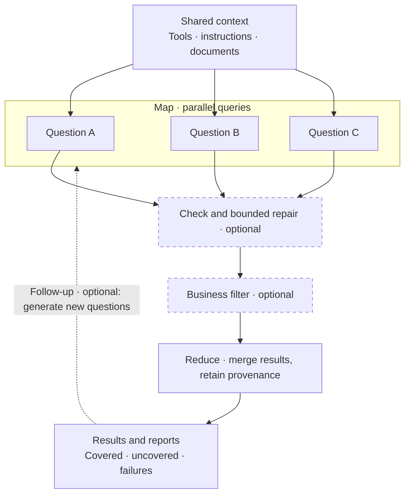
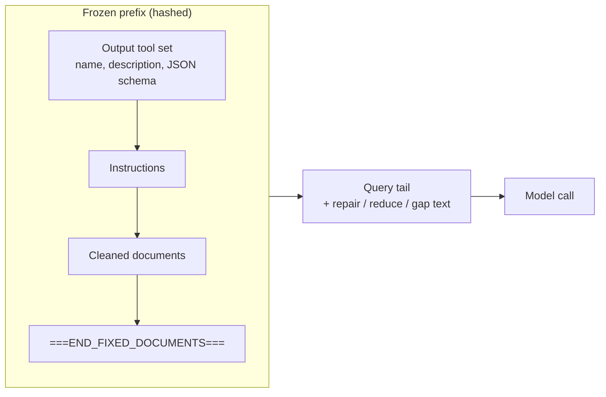
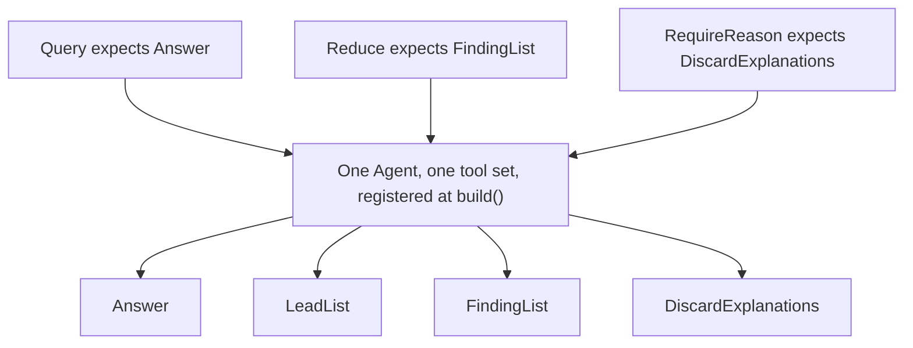

<p align="center">
  
</p>
<h1 align="center">forkreduce</h1>

forkreduce is a small Python framework, built on [Pydantic AI](https://ai.pydantic.dev/), for the case where many LLM queries share one long context.


## Installation

Requires Python 3.11 or newer.

```bash
pip install forkreduce
```

The Temporal adapter is optional: `pip install "forkreduce[temporal]"`. The core package never imports it.

## Quick start

Ask two questions about the same document (map), then merge the answers into a summary with provenance (reduce). This example calls a real model; first configure an OpenAI-compatible endpoint:

```bash
export OPENAI_API_KEY="your-api-key"
export OPENAI_MODEL="your-model-name"
# Optional for a custom endpoint:
# export OPENAI_BASE_URL="https://your-provider.example/v1"
```

```python
import asyncio
from pydantic import BaseModel
from forkreduce import Query, Traced, build, openai_compatible_model


class Answer(BaseModel):
    text: str


class Summary(Traced):
    text: str


async def main() -> None:
    session = build(
        openai_compatible_model(),
        documents="Eligible titles: Science Digest and River Almanac. Deadline: 30 April 2026.",
        instructions="Answer only from the document.",
        outputs=[Answer, Summary],
    )
    result = await (
        session.map([
            Query(id="titles", tail="Which titles are eligible?", output=Answer),
            Query(id="deadline", tail="What is the deadline?", output=Answer),
        ])
        .reduce(output=Summary, instructions="Combine both answers into one concise summary.")
        .run()
    )
    if result.merged is not None:
        print(result.merged.text)
    if result.failures:
        print(result.failures)


asyncio.run(main())
```

Example output (wording depends on the model):

```text
Eligible titles are Science Digest and River Almanac; the deadline is 30 April 2026.
```

Provide the documents and instructions once at `build()`. Map and reduce share that prefix; only their query tails change. Register both output types up front; `Summary` inherits provenance tracking from `Traced`, and the merged result is available as `result.merged`. By default, the first map query finishes as a warmup before the rest run concurrently. Actual cache hits depend on the provider. For an offline example with no API key, see the `TestModel` example below.

## Full workflow example

Add citation checks, bounded repair, a business filter, and a merge. `TestModel` generates test data to demonstrate the API flow, not real document extraction.

The notice below is fictional. Northbridge is not a real city, and the titles and quantities are invented.

```python
import asyncio
from pydantic import BaseModel, Field
from pydantic_ai.models.test import TestModel

from forkreduce import (
    Block,
    CitationCheck,
    CitationRepair,
    Document,
    Query,
    Traced,
    build,
)


class Answer(BaseModel):
    """One fact from the notice."""

    text: str
    quote: str
    block_id: str


class Finding(Traced):
    topic: str
    summary: str
    source_ids: list[str] = Field(default_factory=list)


class FindingList(BaseModel):
    """Merged findings."""

    items: list[Finding]


notice = Document(
    doc_id="nb-lib-2026-per",
    title="Northbridge Public Library 2026 periodical subscription notice",
    blocks=[
        Block(block_id="titles", text="Eligible titles are the Northbridge Science Digest and the River Almanac."),
        Block(block_id="deadline", text="Offers must reach the front desk by 30 April 2026."),
    ],
)


async def main() -> None:
    # TestModel needs no network. Pass any pydantic-ai Model in production.
    session = build(
        TestModel(custom_output_args={"text": "see notice", "quote": "Eligible titles", "block_id": "titles"}),
        documents=notice,
        instructions="Answer only from the notice. Cite a quote and its block_id.",
        outputs=[Answer, FindingList],
    )
    result = await (
        session.map([Query(tail="Which titles are eligible?", output=Answer, id="titles")])
        .check(CitationCheck(), repair=CitationRepair(max_rounds=2))
        .filter(lambda item: bool(item.quote))
        .reduce(output=FindingList, instructions="Merge the cited facts.")
        .run()
    )
    print(result.failures, result.cache_hit_rate)


asyncio.run(main())
```

`examples/run_offline.py` is a fuller script: a `FunctionModel` walks map, citation check, a coverage policy, and gap-fill against the same notice.

## Why

A long document plus a short question is a bad unit of work when you have dozens of questions. Sending the document on every call spends the same input tokens again, and the answers do not share a schema or a way to say where they came from.

Prefix caching changes the cost shape. Providers that cache a stable prompt prefix charge much less, and answer much faster, for the tokens they have already seen. That only works when the prefix is byte-for-byte stable: same tools, same instructions, same documents, and a tail that varies. forkreduce's job is to keep that prefix frozen and to give the map/reduce steps around it a place to live.

The framework does not know your domain. It will not decide that a missing "deadline" is fatal or that a citation failure should be dropped. It reports the facts and runs the action your policy returns.

## Concepts

| Piece | What it is |
| --- | --- |
| **Session** | Built by `build()`. Holds the frozen prefix, the output types, the model, and the execution policy. |
| **Prefix** | Instructions + cleaned documents + the end marker, and (in tools mode) the tool set. Hashed for cache identity. |
| **Query** | A tail, an expected output type, and optional message history for continuing a branch. |
| **Map** | Many queries on one session. The first batch can warm the cache before concurrency opens. |
| **Check / repair** | A check reports problems. A repair may continue the branch, and code copies back only the allowed fields. |
| **Filter** | Your predicate. Outputs that fail it stay on the run and are left out of the reduce. |
| **Reduce** | One or more queries on the same prefix. Entries carry `source_ids`. A coverage policy decides what to do with gaps. |
| **Follow-up** | A hook between rounds. The built-in `GapFill` asks for missing leads and turns them into the next map. |

### Query and reduce flow



### What sits in the cache prefix



In `prompted` mode the tool list is empty. The expected schema is appended to the tail, so it is not part of the prefix.

### Tool set



Every output type you will ask for, including `DiscardExplanations` if a policy may request reasons, is registered up front. A later call that names an unregistered type raises `UnregisteredOutputError` before any model call. In tools mode, a reply that uses a different registered tool is a validation failure and is retried.

## API by concept

### Session and `build`

```python
session = build(
    model,                          # any pydantic-ai Model
    documents=notice,               # str, sequence of str, Block, Document, or a sequence of those
    instructions="...",
    outputs=[Answer, FindingList],  # unique BaseModel subclasses; tool name is the class name
    output_mode="tools",            # or "prompted"
    policy=Policy(concurrency=8, retries=2),
    warmup=True,
    executor=None,                  # default LocalExecutor(policy)
    model_settings={"temperature": 0},  # sent on every call
)
```

`session.prefix_hash` is a SHA-256 of a canonical JSON document: version, output mode, instructions, cleaned documents, and each tool's name, description, and schema. Rebuilding the same session produces the same hash. Changing a tool schema, the instructions, or the document text changes the hash.

`documents` accepts a string (one block, id `b1`), a sequence of strings (`b1`, `b2`, ...), or `Block` / `Document` values. Text is stripped of control characters before it is rendered or hashed. The rendered prefix ends with a line `===END_FIXED_DOCUMENTS===`.

`Block.meta` is stored and, by default, not rendered, so existing prefix hashes stay the same. Opt in with `meta_keys` (a list of keys, rendered in that order) or `meta_renderer` (a callable). Rendered meta is part of the prefix and the hash. Pass one of the two, not both.

```python
session = build(
    model,
    documents=Document(
        doc_id="notice",
        blocks=[Block(block_id="b1", text="Hours are 9 to 5.", meta={"page": "3"})],
    ),
    instructions="Answer from the notice.",
    outputs=[Answer],
    meta_keys=["page"],  # writes [meta {"page":"3"}] under the block
)
```

### Query and QueryResult

```python
query = Query(
    tail="Which titles are eligible?",
    output=Answer,          # must be registered
    id="titles",            # assigned q1, q2, ... when omitted
    history=None,           # None starts at the prefix; previous.messages continues a branch
    meta={},
    round=0,
    model_settings={"temperature": 0.2},  # overrides the session value for this call
)
result = await session.ask(query)
# or
results = await session.fork([query, other])
```

`QueryResult` fields:

| Field | Meaning |
| --- | --- |
| `query_id` | The query id. |
| `output` | The parsed model, or `None` on failure. |
| `messages` | Full branch transcript (`all_messages()`), so you can continue it. |
| `prefix_hash` | The session hash this call used. |
| `usage` | pydantic-ai `RunUsage` for this result, including retries. |
| `cache_hit_tokens` | `cache_read_tokens`, or `details["prompt_cache_hit_tokens"]` when the first is zero. |
| `attempts` | How many model calls this result took. |
| `failure` | A `Failure`, or `None`. |
| `round` | Plan round, starting at 1 inside `Plan.run`. |
| `elapsed_ms` | Wall time summed across attempts. |
| `needs_review` | Set when repair was exhausted and the policy says to keep the output flagged. |
| `dropped` | Set when the output is kept on the run but excluded from reduce. |
| `check_failures` | Problems the check still reports. |

Passing a `history` that does not start with the rendered documents emits `PrefixMismatchWarning` and still runs. The framework does not guess whether you meant a new branch.

`session.map(queries)` returns a lazy `Plan`. `session.reduce(...)` runs a reduce immediately and returns a `ReduceOutcome`.

### Check and repair

`CitationCheck` walks nested models and lists. For each `quote` / `block_id` pair (those field names are the default) it reports:

* `empty_quote` or `empty_block_id`
* `unknown_block` when the id is not in the session documents
* `quote_not_found` when the quote is not a substring of that block after whitespace is collapsed

Matching is case-sensitive.

`CitationRepair(max_rounds=2, allowed_fields=("quote", "block_id"))` continues the same branch and asks for the same output type. Whatever the model returns, `apply` deep-copies the original object and copies only the allowed fields at each failing path. Other fields stay as they were. There is no separate repair schema, so the tool set does not change.

```python
session.map(queries).check(
    CitationCheck(),
    repair=CitationRepair(max_rounds=2),
    on_failure="needs_review",  # or "drop" or "fail"
)
```

`on_failure` overrides `Policy.repair_failure` for items that still fail when repair stops:

* `needs_review` keeps the output and flags `needs_review`
* `drop` excludes it from the reduce and leaves it on the run
* `fail` records a permanent failure, skips the reduce, and does not start later rounds

The default is `needs_review`.

A custom check is a callable `(output, *, documents) -> list[CheckFailure]`. A custom repair implements `max_rounds`, `build_query`, and `apply`.

### Filter

```python
.filter(lambda item: bool(item.quote))
```

Predicates are AND-ed. A rejected output remains on `RunResult.results` and is not passed to the reduce. The framework ships no deterministic reducer; filtering is your hook.

### Semantic reduce and coverage

A reduce is a normal query on the same session, so it hits the same prefix. The tail lists each input as `id: ...` plus its JSON, and asks for `source_ids` copied from those ids.

```python
class ExplainUncovered:
    def decide(self, report):
        if report.uncovered:
            return RequireReason(tuple(report.uncovered))
        return Accept()

session.map(queries).reduce(
    output=FindingList,                 # registered, and entries must carry source_ids
    instructions="Merge the notice into one list.",
    coverage=ExplainUncovered(),
    max_batch=200,                      # larger inputs become a tree of reduces
    max_rounds=3,                       # bound on coverage Retry
)
```

`Provenance` (the default check) requires every traced entry to cite ids that exist. Unknown ids land in `invalid_refs`. Entries with no `source_ids` land in `untraced`. Both are retried inside the batch, up to `Policy.retries`, with a hint to cite only the given ids. A failed model call is not asked again here; the executor already retried it.

`ReduceReport` always lists:

| Field | Meaning |
| --- | --- |
| `covered` | Input ids that appear in some `source_ids`. |
| `uncovered` | Input ids that do not. Present even when the policy accepts. |
| `invalid_refs` | Cited ids that are not in the input. |
| `untraced` | JSON paths of entries that declare no source ids. |
| `reasons` | `DiscardExplanation` rows after `RequireReason`. |
| `kind` | `"reduce"` by default. |

`CoveragePolicy.decide(report)` returns an action. The framework executes it:

| Action | Effect |
| --- | --- |
| `Accept()` | Keep the merge. Uncovered ids stay on the report. This is the default (`AcceptUncovered`). |
| `RequireReason(items)` | Continue the reduce branch and ask for `DiscardExplanations`. The type must already be registered. |
| `Retry(items, hint)` | Reduce again. An empty `items` retries every original id; otherwise only those ids. `hint` is appended to the tail. |
| `Fail(reason)` | Stop. `ReduceOutcome.fatal` is set and the reason is stored. |

`Drop` is not a reduce action. It is used by citation-failure handling and by gap-fill lead policies.

More than `max_batch` inputs are reduced in a tree. Intermediate nodes get alias ids. Before the coverage policy runs, those aliases are expanded back to the original ids on the returned objects. The message history still contains the model's raw tool arguments, which may show the alias ids.

`Traced` is a pydantic base with `source_ids: list[str]`. Subclass it, or declare your own `source_ids` field. If a subclass redeclares the field, give it a default so the model can omit it only when you mean that; the provenance check still treats a missing or empty list as untraced.

### Follow-up and gap-fill

```python
def more(state, session):
    if state.round >= 2:
        return []
    return [Query(tail="What is still missing?", output=Answer)]

session.map(queries).reduce(output=FindingList).followup(more, max_rounds=2)
```

`followup(fn, max_rounds=2)` calls `fn(state, session)` after each round except the last. `max_rounds` counts map rounds, including the first. An empty list ends the run. Without `followup`, a plan runs a single round.

`RoundState` carries `round`, `results`, `outputs`, `merged`, `report`, plus `failures` and `side_results` for calls the hook itself makes. Items that declare a `round` field are stamped with the map round when the round index is greater than zero.

`GapFill` is a built-in strategy:

```python
gap = GapFill(
    lead_output=LeadList,          # registered; reads .leads or .items
    item_output=Answer,            # registered; one query per new lead
    scopes=[Scope("delivery", "how a sealed offer is delivered")],
    instructions="Report blocks in this scope that the merge does not already cite.",
)
```

It asks once per scope, on the same prefix. Leads whose position (`block_id` by default) is already present on the merged output are skipped. A `LeadPolicy` then sees a `LeadReport` and may `Accept`, `Drop` specific positions, or `Fail`. The default is `AcceptLeads`.

### Concurrency, retries, budget

```python
Policy(
    concurrency=8,             # semaphore around model calls
    retries=2,                 # extra attempts after the first
    retry_backoff=0.5,         # seconds; doubles each transport retry, capped by max_backoff
    max_backoff=8.0,
    budget=Budget(
        max_requests=100,
        max_input_tokens=None,
        max_output_tokens=None,
        max_total_tokens=None,
    ),
    repair_failure="needs_review",
    budget_policy=None,        # callable(BudgetReport) -> Accept | Fail | ...
    context_limit=None,        # per-call window in estimated tokens; None skips the local warning
    context_reserve=None,      # prefix headroom; None means min(limit, max(4096, limit // 4))
)
```

Failure classes:

| Kind | Examples | What happens |
| --- | --- | --- |
| `validation` | Wrong tool, schema mismatch, `UnexpectedModelBehavior`, `UsageLimitExceeded` | Retried immediately, up to the bound. |
| `transport` | HTTP 408, 409, 425, 429, and 5xx; timeouts; connection errors | Retried with exponential backoff. |
| `permanent` | Other 4xx, `UserError`, provider `context_overflow`, anything unrecognized | Not retried. Returned on the result. |
| `budget` | A ceiling was already crossed | Not retried. |

Each model call is built with pydantic-ai `retries=0` and `UsageLimits(request_limit=1)`. forkreduce owns the retry loop, so a validation error does not become a hidden inner retry. Failed calls are never removed from the run.

`warmup=True` (the default) runs the first query of the first `fork` / `map` batch to completion before starting the rest, so the provider can store the prefix. There is no extra dummy request. Later forks on that session run fully concurrent. `ask` does not warm up by itself.

Token budgets are cumulative. When any token ceiling is set, model calls are serialized even if `concurrency` is greater than 1. A call is refused only when completed calls have already reached the ceiling. The one in-flight call that crosses a ceiling is allowed, because its size is known only after it returns, and nothing else starts until that usage is recorded. Overshoot is at most that one call, not one call per concurrent slot. Request-count budgets stay concurrent: each call reserves one request before it is sent. A call blocked before it is sent reports `attempts=0` and does not reserve a request.

A response that fails validation is still billed. Its token usage is read from the captured model response and added to the budget and to `QueryResult.usage`. A transport failure that never produces a response has no tokens to recover; the reserved request still counts. `budget_policy` may return `Accept` to force a blocked call through, or `Fail` to block with your reason. The default blocks.

### Context limit

`Policy.context_limit` is the model context window in estimated tokens, separate from the cumulative budget above. The estimate is one token per four characters, rounded up, over the instructions, the tool schemas, the documents (or the continuation history), and the query tail. It is not the provider's tokenizer. The provider is the source of truth: a local estimate never blocks `build()`, `ask`, `fork`, or `map`, and the prompt is not truncated or split into chunks.

When a limit is set and the estimate is over the usable window, forkreduce emits `ContextEstimateWarning` (a `UserWarning`) and logs the same message on the `forkreduce.context` logger, then sends the request anyway.

* At `build()`, the frozen prefix warns when `prefix_estimate > context_limit - reserve`. The warning is stored on `Session.context_warning`.
* At `ask` / `fork` / `map`, a query warns when the full estimate (prefix or history, plus the tail) is greater than `context_limit`. The warning is stored on `QueryResult.context_warning` and listed on `RunResult.context_warnings`. The prefix warning is also copied onto `RunResult.context_warning`.

Each warning records `estimated_tokens`, `limit`, and `reserve`. Equality is inside the window. `context_limit=None` skips the local warning even if `context_reserve` is set.

`context_reserve` is prefix headroom, in the same estimated tokens. `None` (the default) means `min(context_limit, max(4096, context_limit // 4))`. 4096 tokens leaves room for a real tail and a structured reply on an 8k–16k window (half of 8k, a quarter of 16k). On a larger window, a quarter of `context_limit` is the larger of the two, so a prefix that crowds out the per-query work still warns. The value is capped at `context_limit`, so a window smaller than 4096 treats the whole window as headroom and warns on any non-empty prefix estimate without going negative. Set an integer, including `0`, to replace the formula. `0` warns on the prefix only when the prefix itself exceeds the full window. The reserve is not subtracted again for a request warning, because that estimate already includes the tail; it is still recorded on the warning.

A provider that rejects the prompt for context length (HTTP 400 whose body says the maximum context length was exceeded) is a non-retryable `Failure` with code `context_overflow` and `detail["where"] == "provider"`. When the body includes the figures, the message reports those (`reported 9000 tokens exceeds context limit 8192`). Chunked map-then-reduce is not part of v0.1.

`RunResult.usage` is a `UsageSummary`: request count, input and output tokens, cache-hit tokens, elapsed milliseconds, a per-round breakdown, and `cache_hit_rate` (`cache_hit_tokens / input_tokens`). Map calls and their repairs are folded onto the map `QueryResult` so tokens are counted once. Reduce calls are added from the individual calls, not from a second summed copy.

### Continuing a branch

```python
first = await session.ask(Query(tail="Which titles?", output=Answer, id="titles"))
follow = await session.ask(Query(
    tail="Now quote the deadline as well.",
    output=Answer,
    id="titles-more",
    history=first.messages,
))
```

`history` is the full branch, prefix included. Repair and `RequireReason` use the same mechanism.

### Models

Pass any pydantic-ai `Model`, including `TestModel` and `FunctionModel`. For an OpenAI-compatible server:

```python
from forkreduce import openai_compatible_model

model = openai_compatible_model()  # OPENAI_MODEL or FORKREDUCE_MODEL, OPENAI_API_KEY, OPENAI_BASE_URL

model = openai_compatible_model(
    "local-model",
    base_url="http://127.0.0.1:8000/v1",
    timeout=30,
    temperature=0,
    profile={"supports_tools": True},
    extra_body={"chat_template_kwargs": {"enable_thinking": False}},
)
```

The OpenAI client is constructed with `max_retries=0`. forkreduce does the retrying. `timeout`, `profile`, `extra_body`, and the usual sampling keys are pydantic-ai model settings. A `settings={...}` dict passes any other `ModelSettings` key; an explicit argument overrides the same key. `build(..., model_settings=...)` applies settings to every call, and `Query.model_settings` overrides keys for that call. `extra_body` is replaced as a whole, not merged field by field.

### Temporal (optional)

`import forkreduce` does not import `temporalio`. The adapter is `forkreduce.contrib.temporal` and needs `pip install "forkreduce[temporal]"`.

Each query is one activity. The activity calls `Session.run_once` (a single attempt) and raises `ApplicationError`. `non_retryable` follows `Failure.retryable`: validation and transport stay retryable; permanent failures and budget exhaustion do not. `temporal_retry_policy(policy)` sets `maximum_attempts` to `policy.retries + 1`.

The idempotency key is `forkreduce:{prefix_hash}:{query_id}` via `activity_id`. Register the built session on the worker with `register_session(session)` before the workflow runs. Registering another session with the same prefix hash but a different model, request-body settings, model profile, or policy raises `ForkReduceError`; call `unregister_session` first. The same fingerprint may replace the session. `timeout` and `extra_headers` are not part of the fingerprint. A per-query `model_settings` override is not either; pass it to `query_activity_input(..., model_settings=...)` so the worker applies it for that activity. The workflow payload carries the prefix hash, the tail, the output name, and the retry budget (`max_attempts`, backoff), not the model. `MapQueriesWorkflow` uses that budget. `query_activity_input(session, ...)` copies `Policy.retries + 1` into `max_attempts`. Without a message store, pass the previous activity's `messages_json` back as `history_json` to continue a branch.

Large transcripts should not be activity return values. Pass a `MessageStore` to `set_message_store`. With a store, the activity returns `messages_ref` and leaves `messages_json` empty. Without one, messages are inlined, which is fine for tests and a poor fit for real histories. `InMemoryMessageStore` is process-local.

`MapQueriesWorkflow` fans the activities out. It does not call the model itself. Deterministic decisions (coverage math, lead filtering) can run in the workflow after the activities return; model calls stay in activities.

```python
from forkreduce.contrib.temporal import (
    InMemoryMessageStore,
    MapQueriesWorkflow,
    QueryActivityInput,
    register_session,
    run_query_activity,
    set_message_store,
    temporal_retry_policy,
)

register_session(session)
set_message_store(InMemoryMessageStore())
```

## Caching caveats

**Fixed schema.** Tool definitions are part of the prefix. Providers render tools before messages, and forkreduce does not add tools later. A new output type, a renamed field, or a changed description changes `prefix_hash` and misses the cache for every query, not just the one with the new tail. `Literal` enums need an `"other"` (or similar) escape so one unexpected value does not force a schema change later.

**Control characters.** Some providers reject tool-call JSON that contains raw control characters. forkreduce strips C0 controls other than tab, newline, and carriage return, and strips DEL, before rendering and hashing. The hash of a document with a null byte matches the hash of that document without it.

**Warmup.** The first request creates the cache entry. `warmup=True` finishes that request before the rest of the first batch starts. Firing the whole batch at once can miss the cache on every call.

**Cache expiry.** Providers expire prefix caches on their own schedule (often on the order of minutes of idle time, sometimes longer). forkreduce cannot refresh a cache it does not own. A later batch after a long gap may miss, pay full input price, and then hit again. The hash still tells you whether you sent the same prefix.

**History.** Continuing a branch sends the prior question and answer as well as the prefix. That also hits a prefix cache, including the earlier turns, as long as those bytes are unchanged. Timestamps and run ids are not part of the prefix check; the check compares the rendered document text.

**Prompted mode.** `output_mode="prompted"` puts no tools on the agent. The schema of the expected type is appended to the tail only, so different queries can use different registered types without busting the prefix. The tool-mode cache is more stable when every call shares one tool list, which is why `"tools"` is the default.

**Sampling and transport.** `temperature`, `top_p`, `max_tokens`, `seed`, penalties, `stop_sequences`, `timeout`, and `extra_headers` do not change the frozen prefix, so they do not bust a provider prefix cache. `extra_body` does not change those bytes either. Sampling parameters and `extra_body` do change the JSON body, so Temporal treats a different value as a different execution and `register_session` rejects it. `timeout` and `extra_headers` are transport options and are left out of that fingerprint.

**Profile and block meta.** A model `profile` can change how tools or schemas are rendered on the wire. That can miss the provider cache even when `prefix_hash` is unchanged, which is why the resolved profile is part of the execution fingerprint. `Block.meta` is omitted unless you pass `meta_keys` or `meta_renderer`. Opting in writes meta into the document text, which changes `prefix_hash` and the cached prefix.

## FAQ

**Does the reduce have to use the same output type as the map?** No. It must be one of the types registered at `build()`. Map queries and the reduce can differ.

**What if the model cites an id I never sent?** It is `invalid_refs`. The batch retries up to the policy bound. If the model keeps inventing ids, they stay on the report and the default policy still accepts the merge. A stricter policy can `Fail` or `Retry`.

**Are uncovered items deleted?** No. `Accept` keeps them on `ReduceReport.uncovered`. Use `RequireReason` when a person should see why they were left out.

**Can I reduce without a plan?** Yes. `await session.reduce(items, output=FindingList, id_of=...)`.

**Where do API keys live?** Only in the environment, or in arguments you pass to `openai_compatible_model`. This repository has no `.env` and no embedded keys.

**Does core import Temporal?** No. A subprocess that imports `forkreduce` does not load `temporalio`.

## Development and testing

From a checkout:

```bash
pip install -e ".[dev]" -r benchmarks/requirements.txt
ruff check src tests examples benchmarks && ruff format --check src tests examples benchmarks
mypy
pytest
```

Examples run offline with no key:

```bash
python examples/run_offline.py
```

A live OpenAI-compatible endpoint is optional. The process exits immediately when `OPENAI_API_KEY` is unset.

```bash
OPENAI_API_KEY=... OPENAI_MODEL=... OPENAI_BASE_URL=... python examples/run_live.py
```

`FORKREDUCE_MODEL` is accepted as another name for the model.

The source-tree [CUAD benchmark](benchmarks/README.md) compares fork/reduce,
multi-step tool use, and one-shot answering. `python -m benchmarks estimate`
downloads public data and estimates costs without model calls;
`python -m benchmarks smoke` exercises all adapters with a local `FunctionModel`.
Paid execution requires separate approval of the estimate and explicit opt-in.


## Releasing

PyPI publishes from a git tag. `.github/workflows/release.yml` builds the sdist and wheel, checks them, and uploads with [Trusted Publishing](https://docs.pypi.org/trusted-publishers/). The repository has no PyPI token. The publisher is the `pypi` environment on `426ai/forkreduce`, workflow `release.yml`.

1. Set the same version in `pyproject.toml` (`version`) and `src/forkreduce/__init__.py` (`__version__`).
2. Commit that change on `main`.
3. Tag that commit and push the tag:

```bash
git tag vX.Y.Z
git push origin vX.Y.Z
```

The tag is `v` plus the version string: `0.1.0` is `v0.1.0`. The workflow fails when they differ. You can also run the Release workflow by hand from the Actions tab, but only on an existing `v*` tag.

## Roadmap

v0.1.0 is the first public cut: one session, local execution, citation check/repair, semantic reduce with coverage actions, gap-fill, usage stats, and an optional Temporal activity wrapper.

Not in this version, and reasonable later:

* more built-in checks than citations
* a durable `MessageStore` implementation (object storage, a database)
* streaming partial results
* explicit cache-warmup metrics separated from the first real query
* a second workflow runtime behind the same `Executor` protocol
* opt-in chunked map-then-reduce when a prompt is larger than the context window (the local estimate only warns; a provider context-length error still fails the call)

## License

MIT. See [LICENSE](https://github.com/426ai/forkreduce/blob/main/LICENSE).
