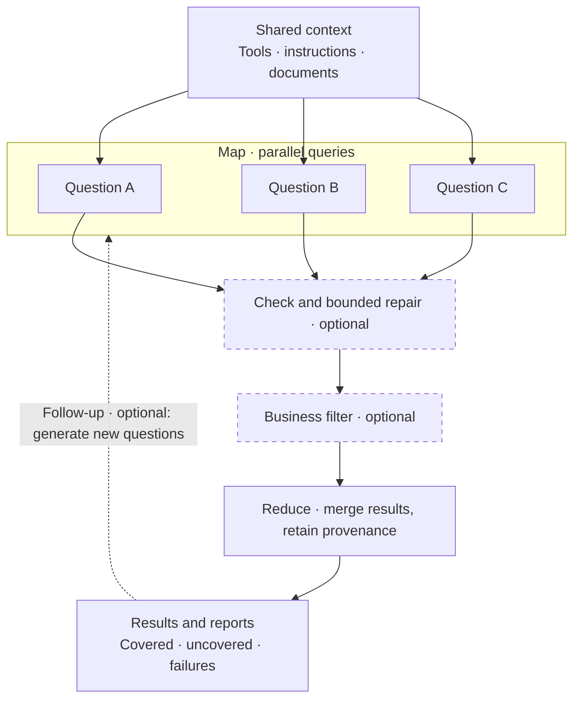
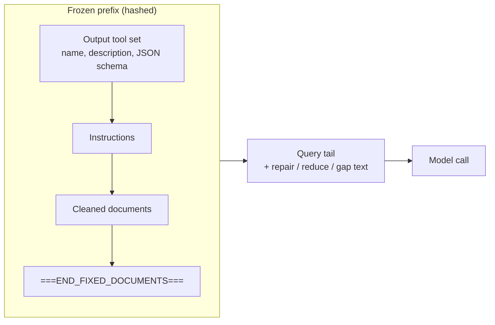
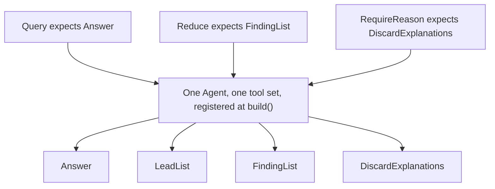

<p align="center">
  
</p>
<h1 align="center">forkreduce</h1>

forkreduce is a small Python framework, built on [Pydantic AI](https://ai.pydantic.dev/), for the case where many LLM queries share one long context.


## Installation

Requires Python 3.11 or newer.

```bash
pip install "forkreduce[openai]"
```

The Temporal adapter is optional: `pip install "forkreduce[temporal]"`. The core package never imports it.

The base install uses `pydantic-ai-slim` without provider SDKs. Use `[openai]` for the OpenAI-compatible helper, or `[full]` for the Pydantic AI provider bundle. Applications that previously relied on transitive vendor SDKs must install `forkreduce[full]` or their chosen slim provider extra explicitly. Without OpenAI installed, core/TestModel imports still work and the helper raises an actionable `ImportError`. This dependency change does not change hashes or default execution behavior.

The source version in this checkout is **0.2.0**. Updating metadata does not publish a package. To install this checkout before publication, use `pip install -e .` or `pip install -e ".[temporal]"`; the commands above install the version currently published on PyPI.

## Quick start

Ask two questions about the same document (map), then merge the answers into a summary with provenance (reduce). This example calls a real model; first configure an OpenAI-compatible endpoint:

```bash
export OPENAI_API_KEY="your-api-key"
export OPENAI_MODEL="your-model-name"
# Optional for a custom endpoint:
# export OPENAI_BASE_URL="https://your-provider.example/v1"
```

```python
import asyncio
from pydantic import BaseModel
from forkreduce import Query, Traced, build, openai_compatible_model


class Answer(BaseModel):
    text: str


class Summary(Traced):
    text: str


async def main() -> None:
    session = build(
        openai_compatible_model(),
        documents="Eligible titles: Science Digest and River Almanac. Deadline: 30 April 2026.",
        instructions="Answer only from the document.",
        outputs=[Answer, Summary],
    )
    result = await (
        session.map([
            Query(id="titles", tail="Which titles are eligible?", output=Answer),
            Query(id="deadline", tail="What is the deadline?", output=Answer),
        ])
        .reduce(output=Summary, instructions="Combine both answers into one concise summary.")
        .run()
    )
    if result.merged is not None:
        print(result.merged.text)
    if result.failures:
        print(result.failures)


asyncio.run(main())
```

Example output (wording depends on the model):

```text
Eligible titles are Science Digest and River Almanac; the deadline is 30 April 2026.
```

Provide the documents and instructions once at `build()`. Map and reduce share that prefix; only their query tails change. Register both output types up front; `Summary` inherits provenance tracking from `Traced`, and the merged result is available as `result.merged`. By default, the first map query finishes as a warmup before the rest run concurrently. Actual cache hits depend on the provider. For an offline example with no API key, see the `TestModel` example below.

## Full workflow example

Add citation checks, bounded repair, a business filter, and a merge. `TestModel` generates test data to demonstrate the API flow, not real document extraction.

The notice below is fictional. Northbridge is not a real city, and the titles and quantities are invented.

```python
import asyncio
from pydantic import BaseModel, Field
from pydantic_ai.models.test import TestModel

from forkreduce import (
    CITATION_INSTRUCTIONS,
    Block,
    Citation,
    CitationCheck,
    CitationRepair,
    Document,
    Query,
    Traced,
    build,
)


class Answer(Citation):
    """One fact from the notice."""

    text: str


class Finding(Traced):
    topic: str
    summary: str
    source_ids: list[str] = Field(default_factory=list)


class FindingList(BaseModel):
    """Merged findings."""

    items: list[Finding]


notice = Document(
    doc_id="nb-lib-2026-per",
    title="Northbridge Public Library 2026 periodical subscription notice",
    blocks=[
        Block(block_id="titles", text="Eligible titles are the Northbridge Science Digest and the River Almanac."),
        Block(block_id="deadline", text="Offers must reach the front desk by 30 April 2026."),
    ],
)


async def main() -> None:
    # TestModel needs no network. Pass any pydantic-ai Model in production.
    session = build(
        TestModel(custom_output_args={"text": "see notice", "quote": "Eligible titles", "block_id": "titles"}),
        documents=notice,
        instructions="Answer only from the notice. " + CITATION_INSTRUCTIONS,
        outputs=[Answer, FindingList],
    )
    result = await (
        session.map([Query(tail="Which titles are eligible?", output=Answer, id="titles")])
        .check(CitationCheck(), repair=CitationRepair(max_rounds=2))
        .filter(lambda item: bool(item.quote))
        .reduce(output=FindingList, instructions="Merge the cited facts.")
        .run()
    )
    print(result.failures, result.cache_hit_rate)


asyncio.run(main())
```

`examples/run_offline.py` is a fuller script: a `FunctionModel` walks map, citation check, a coverage policy, and gap-fill against the same notice.

## Why

A long document plus a short question is a bad unit of work when you have dozens of questions. Sending the document on every call spends the same input tokens again, and the answers do not share a schema or a way to say where they came from.

Prefix caching changes the cost shape. Providers that cache a stable prompt prefix charge much less, and answer much faster, for the tokens they have already seen. That only works when the prefix is byte-for-byte stable: same tools, same instructions, same documents, and a tail that varies. forkreduce's job is to keep that prefix frozen and to give the map/reduce steps around it a place to live.

The framework does not know your domain. It will not decide that a missing "deadline" is fatal or that a citation failure should be dropped. It reports the facts and runs the action your policy returns.

## Concepts

| Piece | What it is |
| --- | --- |
| **Session** | Built by `build()`. Holds the frozen prefix, the output types, the model, and the execution policy. |
| **Prefix** | Instructions + cleaned documents + the end marker, and (in tools mode) the tool set. Hashed for cache identity. |
| **Query** | A tail, an expected output type, and optional message history for continuing a branch. |
| **Map** | Many queries on one session. The first batch can warm the cache before concurrency opens. |
| **Check / repair** | A check reports problems. A repair may continue the branch, and code copies back only the allowed fields. |
| **Filter** | Your predicate. Outputs that fail it stay on the run and are left out of the reduce. |
| **Reduce** | One or more queries on the same prefix. Entries carry `source_ids`. A coverage policy decides what to do with gaps. |
| **Follow-up** | A hook between rounds. The built-in `GapFill` asks for missing leads and turns them into the next map. |

### Query and reduce flow



### What sits in the cache prefix



In `prompted` mode the tool list is empty. The expected schema is appended to the tail, so it is not part of the prefix.

### Tool set



Every static BaseModel output type you will ask for, including `DiscardExplanations` if a policy may request reasons, is registered up front. An unregistered static type raises `UnregisteredOutputError` before a model call. In tools mode, a reply using a different registered tool is a validation failure. Per-question `OutputSpec` schemas use the separately declared dynamic-output mode below rather than adding tools per question.

## API by concept

### Session and `build`

```python
session = build(
    model,                          # any pydantic-ai Model
    documents=notice,               # str, sequence of str, Block, Document, or a sequence of those
    instructions="...",
    outputs=[Answer, FindingList],  # unique BaseModel subclasses; tool name is the class name
    output_mode="auto",             # default; or explicitly "tools" / "prompted"
    policy=Policy(concurrency=8, retries=2),
    warmup=True,
    executor=None,                  # default LocalExecutor(policy)
    model_settings={"temperature": 0},  # sent on every call
)
```

`session.prefix_hash` is a SHA-256 of a canonical JSON document: version, **resolved** output mode, instructions, cleaned documents, and each tool's name, description, and schema. Rebuilding the same session produces the same hash. Changing a tool schema, the instructions, or the document text changes the hash. The hash algorithm is unchanged: default `"auto"` resolving to tools preserves the old tools hash; resolving to prompted changes the old default hash. Explicit tools/prompted hashes remain stable. There is no `"auto"` marker in the hash.

`build()` defaults to `output_mode="auto"`: it chooses tools only when the resolved model profile and effective settings support **forced output-tool use**, otherwise prompted JSON validated against the same registered Pydantic type. `session.output_mode` retains the requested mode (`"auto"`, `"tools"`, or `"prompted"`); `session.resolved_output_mode` is `"tools"` or `"prompted"`. Every actual `QueryResult`, including failures and combined reduce results, records `resolved_output_mode`; `None` is only the legacy/manual-construction default. This is a build-time capability decision, not a fallback after a failed provider request. Tools mode never silently accepts JSON text or switches modes after a response. Registered schemas remain part of `prefix_hash` in prompted mode, although their JSON is sent only in query tails, not in the provider's shared prompt prefix.

Explicit modes are honored. Explicit `"tools"` without effective forced-tool support emits `UnforcedToolsWarning` by default; `on_unforced_tools="error"` raises `UnforcedToolsError`, and `"ignore"` suppresses this diagnostic (neither setting adds provider capability). The policy applies at build and when query settings change capability. For an auto session, a `Query.model_settings` override that would change the resolved mode raises `OutputModeConflictError` before budget reservation or a provider call: build a new session with those settings instead. Settings merge shallowly in order: model defaults, build settings, query overrides; a query `extra_body` replaces the whole session value.

The limitation can belong to the **model/vendor API**, especially in thinking mode, rather than a gateway. [MiMo's OpenAI-compatible API reference](https://mimo.mi.com/docs/en-US/api/chat/openai-api) documents that non-`auto` `tool_choice` values are removed and behave as `auto`; [DeepSeek issue #1376](https://github.com/deepseek-ai/DeepSeek-V3/issues/1376) reports HTTP 400 for forced choices while thinking is enabled. [Pydantic AI PR #7450](https://github.com/pydantic/pydantic-ai/pull/7450) describes request-dependent forcing and implicit downgrades to `auto`. These sources do not establish that every model or endpoint has the same restriction. Supply an accurate `profile` for a custom endpoint; `supports_tools=True` alone does not promise forced output.

In installed Pydantic AI 2.61, the public `ModelProfile` fields all exist with these defaults:

| Field | Default | Meaning |
| --- | --- | --- |
| `supports_tools` | `True` | Can use tools at all. |
| `supports_forced_tool_choice` | `True` | Accepts required/named forced tool choice. When false, SDK-generated forcing can become `auto`; explicit forcing raises an SDK `UserError`. |
| `supports_forced_tool_choice_with_thinking` | `True` | Forcing remains supported while this request thinks. |
| `thinking_enabled_by_default` | `False` | Thinks when no setting overrides it; does not mean thinking is impossible to disable. |
| `supports_thinking` | `False` | Supports unified thinking configuration; when false the SDK ignores unified `thinking`. |
| `thinking_always_enabled` | `False` | Thinking cannot be disabled; implies thinking support, and `thinking=False` only selects the lowest accepted effort. |
| `forced_tool_choice_disables_thinking` | `False` | Forcing would suppress thinking; while thinking is active, the SDK avoids its implicit output-tool forcing. |

`default_structured_output_mode="tool"` is the SDK's preference, not a capability guarantee. forkreduce's auto rule selects only tools or prompted output, never native structured output.

The exact rule requires both tools and forced-tool support; while thinking is active it also requires `supports_forced_tool_choice_with_thinking=True` and `forced_tool_choice_disables_thinking=False`. `thinking_always_enabled` always wins. Recognized provider controls take precedence over unified `thinking`: `openai_reasoning_effort` / `extra_body.reasoning_effort` (`none` disables); `anthropic_thinking.type` / `extra_body.thinking.type` (enabled/adaptive enables, disabled disables); boolean `extra_body.chat_template_kwargs.enable_thinking` (also in top-level `chat_template_kwargs`); and `google_thinking_config.thinking_budget` (zero disables, other values including -1 enable) or `thinking_level` (minimal/low/medium/high all enable). Conflicting controls conservatively mean active thinking. Otherwise unified `thinking` is honored only with `supports_thinking=True`, then the rule falls back to `thinking_enabled_by_default`. Unknown non-`None` thinking/reasoning-shaped settings, including malformed recognized controls, raise `ForkReduceError` with code `unknown_thinking_control` in auto; explicit tools treats forcing as unavailable and applies the warning policy, while explicit prompted is honored. Display-only `include_thoughts`, `openai_reasoning_summary`, and `openai_reasoning_generate_summary` do not enable thinking. There are no model-name guesses.

Thinking controls are inspected only when they can change forcing capability: if tools or forcing are unsupported, auto resolves directly to prompted; if forcing works with thinking and does not disable it, auto resolves directly to tools. These unconditional profiles do not reject irrelevant unknown thinking controls. The unknown-control error and conservative explicit-tools diagnostic above apply only to conditional profiles.

Give reasoning models output headroom: a provider's completion cap can include both reasoning tokens and the visible answer. A small `max_tokens` may be exhausted before any JSON or tool arguments appear. For example, pass `model_settings={"max_tokens": 8192}` to `build()` (or `max_tokens=8192` to `openai_compatible_model()`) and size it for your workload and provider; 8,192 is an example, not a guarantee against truncation or a billing limit. Do not assume a gateway supports reasoning-effort controls without checking its contract.

[MiMo's deep-thinking guide](https://mimo.mi.com/docs/en-US/quick-start/usage-guide/text-generation/deep-thinking) also documents that its listed thinking models ignore requested `temperature`/`top_p` and use `1.0`/`0.95`. Thus requesting `temperature=0` does not guarantee deterministic output in that mode.

`documents` accepts a string (one block, id `b1`), a sequence of strings (`b1`, `b2`, ...), or `Block` / `Document` values. Text is stripped of control characters before it is rendered or hashed. The rendered prefix ends with a line `===END_FIXED_DOCUMENTS===`.

`Block.meta` is stored and, by default, not rendered, so existing prefix hashes stay the same. Opt in with `meta_keys` (a list of keys, rendered in that order) or `meta_renderer` (a callable). Rendered meta is part of the prefix and the hash. Pass one of the two, not both.

```python
session = build(
    model,
    documents=Document(
        doc_id="notice",
        blocks=[Block(block_id="b1", text="Hours are 9 to 5.", meta={"page": "3"})],
    ),
    instructions="Answer from the notice.",
    outputs=[Answer],
    meta_keys=["page"],  # writes [meta {"page":"3"}] under the block
)
```

### Document bytes and message layout

`build(document_format="blocks", message_layout="split")` keeps the old default rendering and request layout, including explicit default arguments. `DocumentFormat`, `MessageLayout`, and `QUERY_SEPARATOR` are exported from `forkreduce`.

| Option | Behavior | Prefix identity |
| --- | --- | --- |
| `document_format="blocks"` | Existing cleaned, addressable document/block rendering and end marker. | Default encoding unchanged. |
| `document_format="raw"` | Exact text/control characters, no wrappers or end marker; multiple block texts joined by two newlines, titles/meta omitted. | Opt-in format is hashed. |
| `message_layout="split"` | Existing separate prefix/tail user parts. | Default encoding unchanged. |
| `message_layout="single"` | One initial user part: prefix + `QUERY_SEPARATOR` + tail. | Opt-in layout is hashed. |

`QUERY_SEPARATOR` is `"\n\n===QUERY===\n\n"`. Different questions share the identical prefix/separator bytes; only their tail changes. Continuations append only the new tail to the existing history, and native feedback preserves the original combined head rather than repeating the document. The default flags are omitted from the hash payload, preserving the v0.1.1 bytes/hash fixtures; nondefaults also enter the execution fingerprint. Existing auto-mode capability caveats still apply.

Raw mode deliberately does not sanitize controls or add application delimiters: ensure deterministic input bytes and provider acceptance yourself. Metadata rendering options are rejected in raw mode. There are no framework block addresses: `DocumentIndex.block_text`, `CitationCheck`, and plans using built-in citation checking/repair reject raw mode. Use application-owned addressing/validation instead. Snapshots retain both flags; factories must restore them before hash verification.

For exact caller-owned dynamic tails, set `query_separator="<custom boundary>"` and `dynamic_output_instructions=False` on `build` with raw/single layout. The initial user part is exactly `raw_prefix + query_separator + query.tail`, preserving whitespace/control characters. No output instruction sentence, description, schema or trimming is added; callers supply their own instructions. Schema validation still runs. Only nondefault separators enter prefix hashes; suppressing dynamic guidance is tail-only (fingerprint changes, prefix hash does not). Static tails are unaffected.

Default snapshot fields/bytes remain unchanged. Nondefault layouts use `ConfiguredFrozenPrefix` with `QueryLayout`. On either snapshot type, factories read `frozen.query_separator` and `frozen.dynamic_output_instructions` and pass them to `build`; forgotten opt-in reconstruction is rejected, including cached sessions.

### Query and QueryResult

```python
query = Query(
    tail="Which titles are eligible?",
    output=Answer,          # must be registered
    id="titles",            # assigned q1, q2, ... when omitted
    history=None,           # None starts at the prefix; previous.messages continues a branch
    meta={},
    round=0,
    model_settings={"temperature": 0.2},  # overrides the session value for this call
)
result = await session.ask(query)
# or
results = await session.fork([query, other])
```

`QueryResult` fields:

| Field | Meaning |
| --- | --- |
| `query_id` | The query id. |
| `output` | The parsed model, or `None` on failure. |
| `messages` | Full branch transcript (`all_messages()`), so you can continue it. |
| `prefix_hash` | The session hash this call used. |
| `usage` | pydantic-ai `RunUsage` for this result, including retries. |
| `cache_hit_tokens` | `cache_read_tokens`, or `details["prompt_cache_hit_tokens"]` when the first is zero. |
| `attempts` | How many model calls this result took. |
| `failure` | A `Failure`, or `None`. |
| `round` | Plan round, starting at 1 inside `Plan.run`. |
| `elapsed_ms` | Wall time summed across attempts. |
| `needs_review` | Set when repair was exhausted and the policy says to keep the output flagged. |
| `dropped` | Set when the output is kept on the run but excluded from reduce. |
| `check_failures` | Problems the check still reports. |

Passing a `history` that does not start with the rendered documents emits `PrefixMismatchWarning` and still runs. The framework does not guess whether you meant a new branch.

`session.map(queries)` returns a lazy `Plan`. `session.reduce(...)` runs a reduce immediately and returns a `ReduceOutcome`.

### Per-question JSON schemas

`OutputSpec(name, json_schema, *, description=None, strict=True)` is a serializable, copied JSON-schema contract; `Query.output` accepts it alongside registered BaseModel classes. Accepted dynamic outputs are dictionaries. Schema validation uses JSON Schema without coercion, including local `$ref` / `$defs`, composition, constants and additional-property constraints. Remote references are rejected to avoid implicit network I/O. `strict=True` additionally checks known formats and strict JSON values (no NaN/Infinity); `strict=False` omits optional format checks but never disables schema/type validation.

```python
from forkreduce import OutputSpec, Policy, Query, build

count = OutputSpec("Count", {
    "type": "object", "properties": {"value": {"type": "integer", "minimum": 0}},
    "required": ["value"], "additionalProperties": False,
})
label = OutputSpec("Label", {
    "type": "object", "properties": {"value": {"type": "string", "minLength": 1}},
    "required": ["value"], "additionalProperties": False,
})
session = build(
    model, documents="Synthetic shared evidence.", instructions="Use the evidence.",
    outputs=[], dynamic_outputs="generic_tool", policy=Policy(output_feedback_retries=1),
)
results = await session.fork([
    Query(id="count", tail="Return the count.", output=count),
    Query(id="label", tail="Return the label.", output=label),
])
```

Prompted mode puts only this question's schema in its tail. `dynamic_outputs="generic_tool"` opts into one fixed permissive object output tool, `forkreduce_dynamic_output`; this same tool and all registered static tools remain present for every question. The specific schema stays in the tail and is checked after parsing. Invalid outputs raise native `ModelRetry` feedback within `Policy.output_feedback_retries`; worker-local application validators can further validate dictionaries. Different question schemas never change the session prefix hash. Enabling the generic tool does change the frozen tool set/hash; leaving dynamic support off preserves old hashes.

For dynamic-capable auto sessions, a supported forced-output profile plus `generic_tool` selects tools; otherwise prompted is selected. Use `dynamic_outputs="prompted"` to declare that intent explicitly; `outputs=[]` without a generic tool also selects prompted in auto. Existing fixed-output auto sessions retain their previous resolution. A frozen static-tools session without the generic tool cannot accept dynamic schemas: build a separate prompted/dynamic session instead of changing its cached tool list. Explicit tools requires the generic option for dynamic queries.

Temporal accepts `query_activity_input(..., output_spec=count)` (optional matching `output_name`), or an `OutputSpecRef` for large schemas. Both converters reconstruct inline specs/references in queries and follow-ups; factories restore frozen dynamic settings. Dictionary results use existing JSON/reference fields. Inline schemas still enter workflow history: use references and bounded generation below when scaling. Built-in BaseModel citation checking/repair is not a dictionary-schema validator; use validators/reference-aware hooks. **Run real-model regressions before switching output modes; offline tests do not establish provider extraction quality.**

#### Referenced schemas and large query collections

Prepare outside workflows with a client/activity-owned writer and the existing store:

```python
from forkreduce.contrib.temporal import OutputSpecWriter, query_activity_input

writer = OutputSpecWriter(store)  # retain one writer for the preparation job
spec_ref = await writer.store(count, ref_namespace="demo-run")
payload = query_activity_input(
    session, query_id="count", tail="Return the count.", output_spec=spec_ref,
    prefix_ref=prefix_ref, ref_namespace="demo-run",
)
```

`OutputSpecRef(name, ref, sha256, namespace=None)` contains no schema and occupies the existing `output_spec` slot: default/inline payload shapes and bytes remain unchanged. Query inputs, full follow-ups and `AfterQueryInput.query` carry just the reference. Workers use `set_message_store(store)` to resolve/verify digest, name and namespace once per activity attempt; feedback reuses that local spec. Missing blobs fail clearly and non-retryably; differing nonempty routing namespaces use existing `ref_namespace_mismatch`. Set the query namespace for initial prefix routing too. I/O uses `StoreContext.kind="output_spec"`; preparation has no prefix association (`prefix_hash=""`), while reads carry query/activity context.

Keys are content-addressed and namespace-scoped. One retained writer deduplicates equal/concurrent specs even for legacy stores with opaque refs; content-addressed backends also deduplicate across writers/processes. Keep blobs immutable and retained through retries/repairs; do not delete them while reusing the writer cache. Writer state is never serialized.

The official large-list pattern is **activity-generated bounded batches**, not an unbounded `MapQueriesInput` or a resolver returning one giant list. The complete [offline generation example](examples/run_spec_refs_offline.py) sends a small job/range, prepares batches/spec refs in an activity, then composes public `plan_batches` / `execute_query` in a workflow. Both preparation results and model-activity inputs stay bounded. It exercises 300 different synthetic schemas, each over 11 KB, with every workflow/activity input and generation result below 512 KiB, both converters and replay. No workflow storage I/O, `queries_ref` field or new default activity registration is introduced. Applications replace the generation activity's data source while retaining its bounded input/output contract.

```bash
PYTHONPATH=src:. python examples/run_spec_refs_offline.py
PYTHONPATH=src:. python examples/run_spec_refs_offline.py --plugin
```

These require an existing `TEMPORAL_TEST_SERVER` binary and checkout dev/Temporal extras; no download, real provider request or telemetry export occurs.

### Check and repair

`CitationCheck` walks nested models and lists. For each `quote` / `block_id` pair (those field names are the default) it reports:

* `empty_quote` or `empty_block_id`
* `unknown_block` when the id is not in the session documents
* `quote_not_found` when the quote is not a substring of that block after whitespace is collapsed

Matching is case-sensitive.

`Citation` is a reusable Pydantic model with described `quote` and `block_id` fields: use it in a list or inherit it to add answer fields, as above. Each quote must be one contiguous passage entirely inside the single referenced block. Text appearing elsewhere in the document is not a valid quote for that block. Split evidence crossing block boundaries into separate citations with their own block IDs; do not concatenate blocks into one quote.

Append the opt-in `CITATION_INSTRUCTIONS` string to your session instructions when asking for citations. Nothing is injected into unrelated sessions, and the schema and instructions do not replace `CitationCheck`. Adopting `Citation` changes the registered output schema and hence `prefix_hash`; appending the instructions also changes the frozen prompt and hash. Existing custom schemas and instructions retain their previous hashes. Reduce and repair guidance changes only query tails, not the frozen prefix or hash.

`CitationRepair(max_rounds=2, allowed_fields=("quote", "block_id"))` continues the same branch and asks for the same output type. Its instructions repeat the single-block rule; under the default field restriction, repair must shorten a quote or correct its block ID rather than add or split output entries. Whatever the model returns, `apply` deep-copies the original object and copies only the allowed fields at each failing path. Other fields stay as they were. There is no separate repair schema, so the tool set does not change.

```python
session.map(queries).check(
    CitationCheck(),
    repair=CitationRepair(max_rounds=2),
    on_failure="needs_review",  # or "drop" or "fail"
)
```

`on_failure` overrides `Policy.repair_failure` for items that still fail when repair stops:

* `needs_review` keeps the output and flags `needs_review`
* `drop` excludes it from the reduce and leaves it on the run
* `fail` records a permanent failure, skips the reduce, and does not start later rounds

The default is `needs_review`.

A custom check is a callable `(output, *, documents) -> list[CheckFailure]`. A custom repair implements `max_rounds`, `build_query`, and `apply`.

### Filter

```python
.filter(lambda item: bool(item.quote))
```

Predicates are AND-ed. A rejected output remains on `RunResult.results` and is not passed to the reduce. The framework ships no deterministic reducer; filtering is your hook.

### Semantic reduce and coverage

A reduce is a normal query on the same session, so it hits the same prefix. The tail lists each input as `id: ...` plus its JSON and an explicit allowed source-ID list. `source_ids` must identify those input items (for map results, the query/fork IDs), not document or block IDs found inside their values. Replace inherited `source_ids` with the current batch's input IDs; do not mix in evidence addresses.

When inputs contain string `question_id` fields, including nested models, dictionaries, lists, and tuples, the tail also maps each question to its allowed input IDs, for example `{"opening": ["fork:0"], "closing": ["fork:1"]}`. Repeated questions collect all matching input IDs. This is generic guidance, not a domain-specific validator; the provenance check below remains unchanged. Inputs without question IDs work as before, and tree batches use their current alias IDs before final expansion.

```python
class ExplainUncovered:
    def decide(self, report):
        if report.uncovered:
            return RequireReason(tuple(report.uncovered))
        return Accept()

session.map(queries).reduce(
    output=FindingList,                 # registered, and entries must carry source_ids
    instructions="Merge the notice into one list.",
    coverage=ExplainUncovered(),
    max_batch=200,                      # larger inputs become a tree of reduces
    max_rounds=3,                       # bound on coverage Retry
)
```

`Provenance` (the default check) requires every traced entry to cite ids that exist. Unknown ids land in `invalid_refs`. Entries with no `source_ids` land in `untraced`. Both are retried inside the batch, up to `Policy.retries`, with a hint to cite only the given ids. A failed model call is not asked again here; the executor already retried it.

`ReduceReport` always lists:

| Field | Meaning |
| --- | --- |
| `covered` | Input ids that appear in some `source_ids`. |
| `uncovered` | Input ids that do not. Present even when the policy accepts. |
| `invalid_refs` | Cited ids that are not in the input. |
| `untraced` | JSON paths of entries that declare no source ids. |
| `reasons` | `DiscardExplanation` rows after `RequireReason`. |
| `kind` | `"reduce"` by default. |

`CoveragePolicy.decide(report)` returns an action. The framework executes it:

| Action | Effect |
| --- | --- |
| `Accept()` | Keep the merge. Uncovered ids stay on the report. This is the default (`AcceptUncovered`). |
| `RequireReason(items)` | Continue the reduce branch and ask for `DiscardExplanations`. The type must already be registered. |
| `Retry(items, hint)` | Reduce again. An empty `items` retries every original id; otherwise only those ids. `hint` is appended to the tail. |
| `Fail(reason)` | Stop. `ReduceOutcome.fatal` is set and the reason is stored. |

`Drop` is not a reduce action. It is used by citation-failure handling and by gap-fill lead policies.

More than `max_batch` inputs are reduced in a tree. Intermediate nodes get alias ids. Before the coverage policy runs, those aliases are expanded back to the original ids on the returned objects. The message history still contains the model's raw tool arguments, which may show the alias ids.

`Traced` is a pydantic base with `source_ids: list[str]`. Subclass it, or declare your own `source_ids` field. If a subclass redeclares the field, give it a default so the model can omit it only when you mean that; the provenance check still treats a missing or empty list as untraced.

### Follow-up and gap-fill

```python
def more(state, session):
    if state.round >= 2:
        return []
    return [Query(tail="What is still missing?", output=Answer)]

session.map(queries).reduce(output=FindingList).followup(more, max_rounds=2)
```

`followup(fn, max_rounds=2)` calls `fn(state, session)` after each round except the last. `max_rounds` counts map rounds, including the first. An empty list ends the run. Without `followup`, a plan runs a single round.

`RoundState` carries `round`, `results`, `outputs`, `merged`, `report`, plus `failures` and `side_results` for calls the hook itself makes. Items that declare a `round` field are stamped with the map round when the round index is greater than zero.

`GapFill` is a built-in strategy:

```python
gap = GapFill(
    lead_output=LeadList,          # registered; reads .leads or .items
    item_output=Answer,            # registered; one query per new lead
    scopes=[Scope("delivery", "how a sealed offer is delivered")],
    instructions="Report blocks in this scope that the merge does not already cite.",
)
```

It asks once per scope, on the same prefix. Leads whose position (`block_id` by default) is already present on the merged output are skipped. A `LeadPolicy` then sees a `LeadReport` and may `Accept`, `Drop` specific positions, or `Fail`. The default is `AcceptLeads`.

### Output validation feedback

`Policy(output_feedback_retries=0)` preserves the single-request attempt. Opt into a bounded same-branch correction with `Policy(output_feedback_retries=1)` and `build(..., output_validator=validate_output)`. The validator accepts the parsed output, may be synchronous or asynchronous, returns the accepted/replaced value, and raises Pydantic AI `ModelRetry` to send an error back to the model. Schema and cross-field validation errors use the same feedback mechanism. Feedback is not a fresh query: the frozen instructions, document bytes and tool set stay unchanged, while retry messages extend this question's history.

`QueryResult.feedback_retries_used` and `meta["feedback_retries_used"]` record actual feedback requests; local outer attempts aggregate this count. Request/token budgets are enforced before every request, including feedback. `Policy.retries` remains the separate outer retry budget. Feedback and validators do not change `prefix_hash`; non-default feedback/validator configuration changes the Temporal execution fingerprint.

Temporal activities use the worker's registered or factory-created session, never a serialized callback. `FrozenPrefix.output_feedback_retries` records the numeric policy; factories should restore it with `Policy(output_feedback_retries=frozen.output_feedback_retries)` and install their worker-local validator. Activity results and safe failure metadata expose `feedback_retries_used` for the final activity attempt, not an inferred total across Temporal attempts. Keep sensitive data out of validation messages: feedback deliberately sends these messages to the model.

A validator can instead accept `(output, context: OutputValidationContext)`, imported from `forkreduce`. An explicit second positional parameter opts in; context contains `query_id`, `round`, and deep-copied `meta`. Sync/async/native `ModelRetry` work identically. Binding is per query, not on a shared Agent, so concurrent queries cannot overwrite identities. Callbacks remain worker-local and have no prefix-hash impact; one-argument callbacks retain their behavior.

With `output_feedback_retries > 0`, **one activity may make multiple model calls**. Set `start_to_close >= single_call_time * (output_feedback_retries + 1)`, plus factory/store I/O and validation headroom. Two feedback retries with a 60-second single-call bound require at least 180 seconds before overhead. `maximum_attempts` is the independent Temporal outer retry budget; heartbeat timeout does not replace a sufficiently long start-to-close window.

### Concurrency, retries, budget

```python
Policy(
    concurrency=8,             # semaphore around model calls
    retries=2,                 # extra attempts after the first
    retry_backoff=0.5,         # seconds; doubles each transport retry, capped by max_backoff
    max_backoff=8.0,
    budget=Budget(
        max_requests=100,
        max_input_tokens=None,
        max_output_tokens=None,
        max_total_tokens=None,
    ),
    repair_failure="needs_review",
    budget_policy=None,        # callable(BudgetReport) -> Accept | Fail | ...
    context_limit=None,        # per-call window in estimated tokens; None skips the local warning
    context_reserve=None,      # prefix headroom; None means min(limit, max(4096, limit // 4))
)
```

Failure classes:

| Kind | Examples | What happens |
| --- | --- | --- |
| `validation` | Wrong tool, schema mismatch, `UnexpectedModelBehavior`, `UsageLimitExceeded` | Retried immediately, up to the bound. |
| `transport` | HTTP 408, 409, 425, 429, and 5xx; timeouts; connection errors | Retried with exponential backoff. |
| `permanent` | Other 4xx, `UserError`, provider `context_overflow`, anything unrecognized | Not retried. Returned on the result. |
| `budget` | A ceiling was already crossed | Not retried. |

Each model call is built with pydantic-ai `retries=0` and `UsageLimits(request_limit=1)`. forkreduce owns the retry loop, so a validation error does not become a hidden inner retry. Failed calls are never removed from the run.

`warmup=True` (the default) runs the first query of the first `fork` / `map` batch to completion before starting the rest, so the provider can store the prefix. There is no extra dummy request. Later forks on that session run fully concurrent. `ask` does not warm up by itself.

Token budgets are cumulative. When any token ceiling is set, model calls are serialized even if `concurrency` is greater than 1. A call is refused only when completed calls have already reached the ceiling. The one in-flight call that crosses a ceiling is allowed, because its size is known only after it returns, and nothing else starts until that usage is recorded. Overshoot is at most that one call, not one call per concurrent slot. Request-count budgets stay concurrent: each call reserves one request before it is sent. A call blocked before it is sent reports `attempts=0` and does not reserve a request.

A response that fails validation is still billed. Its token usage is read from the captured model response and added to the budget and to `QueryResult.usage`. A transport failure that never produces a response has no tokens to recover; the reserved request still counts. `budget_policy` may return `Accept` to force a blocked call through, or `Fail` to block with your reason. The default blocks.

### Context limit

`Policy.context_limit` is the model context window in estimated tokens, separate from the cumulative budget above. The estimate is one token per four characters, rounded up, over the instructions, the tool schemas, the documents (or the continuation history), and the query tail. It is not the provider's tokenizer. The provider is the source of truth: a local estimate never blocks `build()`, `ask`, `fork`, or `map`, and the prompt is not truncated or split into chunks.

When a limit is set and the estimate is over the usable window, forkreduce emits `ContextEstimateWarning` (a `UserWarning`) and logs the same message on the `forkreduce.context` logger, then sends the request anyway.

* At `build()`, the frozen prefix warns when `prefix_estimate > context_limit - reserve`. The warning is stored on `Session.context_warning`.
* At `ask` / `fork` / `map`, a query warns when the full estimate (prefix or history, plus the tail) is greater than `context_limit`. The warning is stored on `QueryResult.context_warning` and listed on `RunResult.context_warnings`. The prefix warning is also copied onto `RunResult.context_warning`.

Each warning records `estimated_tokens`, `limit`, and `reserve`. Equality is inside the window. `context_limit=None` skips the local warning even if `context_reserve` is set.

`context_reserve` is prefix headroom, in the same estimated tokens. `None` (the default) means `min(context_limit, max(4096, context_limit // 4))`. 4096 tokens leaves room for a real tail and a structured reply on an 8k–16k window (half of 8k, a quarter of 16k). On a larger window, a quarter of `context_limit` is the larger of the two, so a prefix that crowds out the per-query work still warns. The value is capped at `context_limit`, so a window smaller than 4096 treats the whole window as headroom and warns on any non-empty prefix estimate without going negative. Set an integer, including `0`, to replace the formula. `0` warns on the prefix only when the prefix itself exceeds the full window. The reserve is not subtracted again for a request warning, because that estimate already includes the tail; it is still recorded on the warning.

A provider that rejects the prompt for context length (HTTP 400 whose body says the maximum context length was exceeded) is a non-retryable `Failure` with code `context_overflow` and `detail["where"] == "provider"`. When the body includes the figures, the message reports those (`reported 9000 tokens exceeds context limit 8192`). Chunked map-then-reduce is not part of v0.1.

`RunResult.usage` is a `UsageSummary`: request count, input and output tokens, cache-hit tokens, elapsed milliseconds, a per-round breakdown, and `cache_hit_rate` (`cache_hit_tokens / input_tokens`). Map calls and their repairs are folded onto the map `QueryResult` so tokens are counted once. Reduce calls are added from the individual calls, not from a second summed copy.

### Continuing a branch

```python
first = await session.ask(Query(tail="Which titles?", output=Answer, id="titles"))
follow = await session.ask(Query(
    tail="Now quote the deadline as well.",
    output=Answer,
    id="titles-more",
    history=first.messages,
))
```

`history` is the full branch, prefix included. Repair and `RequireReason` use the same mechanism.

### Models

Pass any pydantic-ai `Model`, including `TestModel` and `FunctionModel`. For an OpenAI-compatible server:

```python
from forkreduce import openai_compatible_model

model = openai_compatible_model()  # OPENAI_MODEL or FORKREDUCE_MODEL, OPENAI_API_KEY, OPENAI_BASE_URL

model = openai_compatible_model(
    "local-model",
    base_url="http://127.0.0.1:8000/v1",
    timeout=30,
    temperature=0,
    profile={"supports_tools": True},
    extra_body={"chat_template_kwargs": {"enable_thinking": False}},
)
```

The OpenAI client is constructed with `max_retries=0`. forkreduce does the retrying. `timeout`, `profile`, `extra_body`, and the usual sampling keys are pydantic-ai model settings. A `settings={...}` dict passes any other `ModelSettings` key; an explicit argument overrides the same key. `build(..., model_settings=...)` applies settings to every call, and `Query.model_settings` overrides keys for that call. `extra_body` is replaced as a whole, not merged field by field.

### Temporal (optional)

Install `forkreduce[temporal]`; core imports never load `temporalio`. Each `forkreduce.run_query` activity calls `Session.run_once` exactly once. Temporal owns retries: validation/transport failures remain retryable, permanent/budget failures do not. Defaults are unchanged: one `forkreduce.map_queries` workflow, five-minute start-to-close, no heartbeat timeout, and `Policy.retries + 1` total attempts.

#### Options and plugin worker

`ActivityOptions` durations are **seconds**. Set them on `build`, override one payload's `activity_options`, or replace them for the whole workflow via `MapQueriesInput.activity_options`. Unspecified retry fields inherit the payload's policy-derived budget/backoff; `maximum_attempts` includes the first attempt. Recipe: **2 attempts / 3 minutes / 30-second heartbeat**.

```python
from forkreduce import ActivityOptions, build
from forkreduce.contrib.temporal import (
    MapQueriesInput, MapQueriesWorkflow, QueryBatchWorkflow,
    query_activity_input, register_session, run_query_activity,
)
from pydantic_ai.durable_exec.temporal import PydanticAIPlugin
from temporalio.client import Client
from temporalio.worker import Worker

session = build(
    model, documents=document, instructions="Answer from the document.", outputs=[Answer],
    activity_options=ActivityOptions(
        start_to_close=180, heartbeat_timeout=30, maximum_attempts=2,
        # schedule_to_close=600, retry_backoff=1, max_backoff=8, backoff_coefficient=2,
    ),
)
register_session(session)  # every activity worker process
client = await Client.connect("localhost:7233", plugins=[PydanticAIPlugin()])
async with Worker(
    client, task_queue="extraction",
    workflows=[MapQueriesWorkflow, QueryBatchWorkflow],
    activities=[run_query_activity],  # inherits the client's plugin
):
    results = await client.execute_workflow(
        MapQueriesWorkflow.run,
        [query_activity_input(session, query_id="q1", tail="What is required?", output_name="Answer")],
        id="extraction-run-1", task_queue="extraction",
    )
```

Both Temporal's default converter and `PydanticAIPlugin`'s `PydanticAIPayloadConverter` have offline workflow/replay coverage. forkreduce's per-query activities coexist with official `TemporalDurability` agents on the same worker: register those agents/workflows normally, without wrapping these activity calls in another retry loop. Install Pydantic AI's `[temporal]` extra for its official integration. For a default-converter worker, set `workflow_runner=SandboxedWorkflowRunner(restrictions=SandboxRestrictions.default.with_passthrough_modules("forkreduce", "pydantic_ai"))`; both classes come from `temporalio.worker.workflow_sandbox`. This avoids reimporting model dependencies inside the sandbox.

When configured, one periodic heartbeat task covers the entire asynchronous query activity: prefix and continuation-history reads, async session-factory construction, the model await, and transcript/output uploads. It stops only when the activity finishes, fails, or is cancelled, so a healthy slow store does not lose heartbeat coverage before or after the model call. Heartbeats signal liveness, not business progress. Blocking the event loop still prevents them: move CPU work to a thread/separate activity and keep a finite start-to-close timeout. Local execution ignores `ActivityOptions`; they never change prefix bytes/hash.

Registration is process-local. Payloads carry hashes, tails, output names, options, and optional per-query `model_settings`, never model instances or Python classes. Conflicting model/request-body settings/profile/policy registrations raise `ForkReduceError`; unregister before replacement. `timeout`/`extra_headers` remain outside the fingerprint. Settings must be JSON-serializable. `activity_id(prefix_hash, query_id)` remains `forkreduce:{prefix_hash}:{query_id}`. Inline single-workflow continuations still accept the previous `messages_json` as `history_json`.

#### Coexisting with Pydantic AI TemporalDurability / PydanticAIPlugin

forkreduce runs its own worker-local Agent inside query activities; it does not route those model calls through `TemporalDurability`. Both execution paths can coexist on the same worker and queue. Build the model in the session factory using your application's resolver (or a `TestModel` / `FunctionModel` for offline work), and pass `instrument=False`, `True`, or `InstrumentationSettings` to `build`. The default is explicitly off, even if an application has set a global Agent instrumentation default. Settings apply to static, feedback and dynamic per-query agents, are never serialized in workflows/snapshots, and change neither hashes nor execution fingerprints. Configure an application-owned OpenTelemetry provider/exporter when collecting spans; `include_content=False` avoids prompt/result text in traces.

For a shared worker, retain the client-side `PydanticAIPlugin` and do not install it again on the worker. The existing `client`, `payloads`, and worker-local `restore` factory are application setup; the full integration recipe below shows factory/store setup. A synthetic official workflow can be registered alongside namespaced forkreduce definitions:

```python
from pydantic_ai import Agent
from pydantic_ai.durable_exec.temporal import PydanticAIWorkflow, TemporalDurability
from pydantic_ai.models.instrumented import InstrumentationSettings
from pydantic_ai.models.test import TestModel
from temporalio import workflow
from temporalio.worker import Worker
from temporalio.worker.workflow_sandbox import SandboxedWorkflowRunner, SandboxRestrictions
from forkreduce.contrib.temporal import (
    QueryActivityOutput, forkreduce_temporal_names, set_default_session_factory,
)

instrumentation = InstrumentationSettings(include_content=False)
official_agent = Agent(
    TestModel(custom_output_args={"text": "offline"}), output_type=Answer,
    name="official-example", capabilities=[TemporalDurability()],
)
official_agent.instrument = instrumentation

@workflow.defn
class OfficialQueryWorkflow(PydanticAIWorkflow):
    __pydantic_ai_agents__ = [official_agent]

    @workflow.run
    async def run(self, question: str) -> str:
        return (await official_agent.run(question)).output.text

set_default_session_factory(restore)  # restore builds with instrument=instrumentation
names = forkreduce_temporal_names(prefix="app.")
runner = SandboxedWorkflowRunner(
    restrictions=SandboxRestrictions.default.with_passthrough_modules("forkreduce", "pydantic_ai")
)
async with Worker(
    client, task_queue="shared-models", workflow_runner=runner,
    workflows=[*names.workflows, OfficialQueryWorkflow], activities=list(names.activities),
):
    official_text = await client.execute_workflow(
        OfficialQueryWorkflow.run, "Synthetic question.", id="official-example", task_queue="shared-models",
    )
    results = await client.execute_workflow(
        names.map_workflow_name, MapQueriesInput(queries=payloads),
        id="fork-example", task_queue="shared-models", result_type=list[QueryActivityOutput],
    )
```

`TemporalNames(prefix="app.")` stores only the prefix as serializable data; `activities` / `workflows` are cached worker-local definitions. Names become `app.forkreduce.run_query`, `app.forkreduce.map_queries`, and `app.forkreduce.query_batch`. Empty prefixes return the original definitions. Namespacing preserves sandboxing, child/query IDs, hashes, custom batch choices and application hook names. Use the same documented passthrough sandbox runner for registration and replay. Custom workflows can pass `MapQueriesInput.activity_name` to `execute_query` when using these definitions.

#### Bounded batches and references

`MapQueriesInput(queries=payloads, batch_size=15, child_concurrency=4)` runs bounded child workflows; register **both** `MapQueriesWorkflow` and `QueryBatchWorkflow`. Results preserve input order. Child IDs derive from the parent workflow ID, prefix hash, and batch index. They stay stable on replay and workflow retries that change the run ID; distinct parent workflow IDs do not collide. This is orchestration identity, not exactly-once provider billing.

Batch mode requires a `MessageStore` and returns `messages_ref` plus `output_ref`, not transcript/structured-output bodies. Parent history is independent of transcript size, but query tails, metadata, and reference lists still occupy history. Keep them small. Batch continuations require `history_ref`, not inline `history_json`. Single-workflow/list-input mode keeps inline behavior for small cases.

`MessageStore` / `PrefixStore` retain the legacy async `put(key, bytes)` / `get(ref)` protocol. A `ContextMessageStore` instead accepts keyword-only `context: StoreContext` on both methods. The adapter inspects signatures before calling; it never retries a write after `TypeError`. Implement shared durable storage for production; `InMemoryMessageStore` is process-local and test-only.

#### Concurrency, queues and cache warmup

`MapQueriesInput(activity_concurrency=None, task_queue=None, warmup="none")` preserves the default fan-out and inherited queue. Set a positive `activity_concurrency` to bound in-flight queries in each child batch, or in the entire direct map when batching is off; `1` is serial. With batches, the upper bound is `child_concurrency * min(batch_size, activity_concurrency)` when a limit is set. Worker capacity and service limits can reduce it further.

`task_queue="model-work"` routes both children and query activities to that queue. Register the child workflow and activity there; the parent workflow may run on a separate queue. Leaving it `None` inherits the current workflow queue.

`warmup="first"` completes the first query before releasing any others. In batched mode, the parent awaits a singleton child at batch index zero, then schedules remaining batches from index one. `warmup="per_batch"` completes each batch's first query before releasing its remaining queries; a direct map is one batch. A returned query/child failure also opens the gate; raise mode still propagates failure and workflow cancellation always propagates. Warmup preserves result order and deterministic IDs but cannot guarantee provider cache hits. These orchestration settings do not change prefix hashes or session execution fingerprints.

#### Composable workflows and per-query hooks

Public helpers in `forkreduce.contrib.temporal` are usable from application workflows:

| API | Contract |
| --- | --- |
| `plan_batches(queries, batch_size)` | Ordered copied batch lists; does not mutate input. |
| `batch_child_id(parent_id, prefix_hash, index)` | Pure deterministic child ID; same algorithm as the built-in map. |
| `require_query_references(query)` | Copies a query into reference-only mode and rejects inline history. |
| `validate_query_references(output)` | Checks a successful result has transcript/output references; safe failure records are exempt. |
| `query_failure(query, error)` | Safe `ActivityError` / `ChildWorkflowError` mapping, without exception text. |
| `await execute_query(query, options=None, *, on_query_failure="raise", task_queue=None, require_references=False, activity_name="forkreduce.run_query")` | Schedules the query activity, derives retries, and applies the requested failure policy. |

For example, an application can choose a serial batch policy while reusing the same reference/failure contract:

```python
from temporalio import workflow
from forkreduce.contrib.temporal import (
    MapQueriesInput, QueryActivityOutput, execute_query, validate_query_references,
)

@workflow.defn(name="app.batch")
class AppBatch:
    @workflow.run
    async def run(self, config: MapQueriesInput) -> list[QueryActivityOutput]:
        results = []
        for query in config.queries:
            result = await execute_query(
                query, config.activity_options, on_query_failure=config.on_query_failure,
                task_queue=config.task_queue, require_references=True,
                activity_name=config.activity_name,
            )
            validate_query_references(result)
            results.append(result)
        return results
```

Register this class and select `MapQueriesInput(batch_workflow="app.batch", ...)`. Custom batches accept `MapQueriesInput` and return an ordered `list[QueryActivityOutput]` with successful reference-only outputs. They own their scheduling, hook handling, and cancellation semantics; the built-in options are input data, not automatic behavior inside arbitrary application workflows.

For the built-in per-question pipeline, set `after_query_activity="app.review"`, `after_query_options=ActivityOptions(...)`, and `max_rounds=1`. The named activity receives `AfterQueryInput(query, output, round, batch_index, parent_workflow_id, meta)` immediately after that question's activity, including returned failures, without waiting for other questions. Hooked queries require shared reference storage even in direct mode. A concurrency slot spans the entire initial-answer → hook → repair → hook pipeline.

Return `AfterQueryDecision(action="done"|"failed"|"follow_up", follow_up_tail=None, follow_up_query=None, result_meta=None)`. A follow-up tail continues from the previous `messages_ref`; a replacement query must keep the prefix hash. IDs become `original_id#r{round}` and round increments automatically. `max_rounds` is the maximum **inclusive round index**: initial round zero, default one permits one repair. A failed decision or another follow-up at the cap becomes `permanent` / `after_query_failed`, not an unapproved success. The last non-None `result_meta` is JSON-copied unchanged into the final result, replaces rather than merges previous metadata, and must fit 16 KiB compact UTF-8 JSON.

`follow_up_tail` retains the current output specification. Switching schemas requires a complete `follow_up_query` (inline or referenced spec). Wrap a replacement as `FollowUpQuery(query, history="fresh")` to restart from the shared prefix, clearing both history fields. The wrapper defaults to `history="continue"`, preserving legacy explicit/inherited history. Prefix retention, automatic round/ID assignment and repair caps still apply. For example, inside a hook:

```python
from dataclasses import replace
from forkreduce.contrib.temporal import AfterQueryDecision, FollowUpQuery

decision = AfterQueryDecision("follow_up", follow_up_query=FollowUpQuery(
    replace(data.query, tail="Re-evaluate independently.",
            output_spec=next_spec_ref, output_name=next_spec_ref.name),
    history="fresh",
))
```

Hook activity errors propagate in raise mode; return mode produces `unknown` / synthetic `after_query_failed`. The complete synthetic failure-type additions are `batch_failed` and `after_query_failed`; neither is an arbitrary raw application-type passthrough. Hook retry/timeouts use their own options (default one attempt, five minutes) on the configured queue. Parent cancellation always propagates. These hooks/round limits do not change prefix hashes or default execution behavior.

Stores must return immutable references: writing new bytes under a reused logical key must not change earlier results or continuation history. The SQLite recipe below uses a content digest in the reference and insert-only writes; identical bytes may reuse a reference. Keep content-addressed references private if equality disclosure is sensitive; a production store may instead allocate opaque unique references.

#### Worker-restart-safe integration

This runnable storage implementation persists across local worker restarts. Use a shared object store/database for distributed workers; every worker must resolve the same references. Application credentials and output classes remain local. `model`, `session`, `Answer`, `questions`, and `client` below are the application objects from the recipe above.

```python
import asyncio
import hashlib
import sqlite3
from pathlib import Path
from pydantic_ai.models.instrumented import InstrumentationSettings
from forkreduce import Policy
from forkreduce.contrib.temporal import (
    StoreContext, delete_ref, freeze_prefix, set_default_session_factory,
    set_prefix_store, set_message_store,
)

class DurableStore:
    def __init__(self, path: str):
        self.path = path
        with sqlite3.connect(path) as db:
            db.execute("CREATE TABLE IF NOT EXISTS blobs (ref TEXT PRIMARY KEY, body BLOB)")

    def execute(self, sql, args):
        with sqlite3.connect(self.path) as db:
            return db.execute(sql, args).fetchone()

    async def put(self, key: str, payload: bytes, *, context: StoreContext) -> str:
        # Logical keys already include namespace; refs also identify immutable bytes.
        ref = f"{key}:{hashlib.sha256(payload).hexdigest()}"
        await asyncio.to_thread(self.execute, "INSERT OR IGNORE INTO blobs VALUES (?, ?)", (ref, payload))
        return ref

    async def get(self, ref: str, *, context: StoreContext) -> bytes:
        row = await asyncio.to_thread(self.execute, "SELECT body FROM blobs WHERE ref = ?", (ref,))
        if row is None:
            raise KeyError(ref)
        return row[0]

    async def delete(self, ref: str, *, context: StoreContext) -> None:
        await asyncio.to_thread(self.execute, "DELETE FROM blobs WHERE ref = ?", (ref,))
        # SQL DELETE is a no-op for missing refs, so repeated cleanup is safe.

store = DurableStore(str(Path("shared-blobs.sqlite")))
app_meta = {"ref_namespace": "demo-run", "schema_version": 1}
# Client or prepare activity, not workflow code:
prefix_ref = await freeze_prefix(session, store, app_meta=app_meta)
payloads = [
    query_activity_input(
        session, query_id=f"q{i}", tail=question, output_name="Answer", prefix_ref=prefix_ref,
        ref_namespace="demo-run",
    )
    for i, question in enumerate(questions)
]

# Every worker startup: no per-prefix registration list to recover.
def restore(frozen):
    assert frozen.app_meta["schema_version"] == 1
    return build(
        model, documents=frozen.documents, instructions=frozen.instructions,
        outputs=[Answer], output_mode=frozen.output_mode,
        on_unforced_tools=frozen.on_unforced_tools,
        dynamic_outputs=frozen.dynamic_outputs,
        document_format=frozen.document_format, message_layout=frozen.message_layout,
        query_separator=frozen.query_separator,
        dynamic_output_instructions=frozen.dynamic_output_instructions,
        policy=Policy(output_feedback_retries=frozen.output_feedback_retries),
        instrument=InstrumentationSettings(include_content=False),
    )

set_prefix_store(store)
set_message_store(store)
set_default_session_factory(restore)
# Execute while a worker registering both workflows and run_query_activity is running:
results = await client.execute_workflow(
    MapQueriesWorkflow.run,
    MapQueriesInput(queries=payloads, batch_size=15, child_concurrency=4, on_query_failure="return"),
    id="extraction-run-2", task_queue="extraction",
)
for result in results:
    if result.failure_kind is not None:
        print(result.query_id, result.failure_kind, result.failure_message, result.attempts)
    else:
        context = StoreContext(kind="output", prefix_hash=result.prefix_hash, namespace="demo-run")
        answer = Answer.model_validate_json(await store.get(result.output_ref, context=context))
# Continue successful queries with history_ref=result.messages_ref.
# Only after the application ends the reference retention lifetime:
# await delete_ref(store, ref, context=StoreContext(kind="prefix", prefix_hash=session.prefix_hash,
#                                                namespace="demo-run"))
```

`on_query_failure="raise"` remains the default, including legacy list inputs, and propagates failures as before. `"return"` preserves input order and returns mixed successes/failures in `QueryActivityOutput`; failures have `failure_kind`, `failure_type`, a bounded payload-free `failure_message`, and `attempts`, without transcript/output bodies or references. The complete `failure_kind` contract is:
`QueryFailureKind`, exported from `forkreduce.contrib.temporal`, is the public `Literal` alias for the six non-`None` values below; `None` means success.

| `failure_kind` | Meaning |
| --- | --- |
| `retryable_exhausted` | Retryable failure with Temporal maximum attempts reached. |
| `permanent` | Non-retryable application failure other than budget exhaustion. |
| `budget` | Application budget exhaustion. |
| `timeout` | Temporal activity timeout. |
| `cancelled` | Activity cancellation, not cancellation of the parent workflow. |
| `unknown` | Unrecognized failure, including unclassified application/activity failures or a failed child batch. |

`failure_type` is the raw `ApplicationError.type` only when it is one of `validation`, `transport`, `permanent`, `budget`, `session_factory_missing`, or `ref_namespace_mismatch`; other raw types become `None`, never arbitrary exception text or an invented code. For example, an exhausted validation failure is `retryable_exhausted` / `validation`, while a missing factory is `retryable_exhausted` / `session_factory_missing`. A `ChildWorkflowError` in return mode produces `unknown` / `batch_failed` for every query in that batch with `attempts=0`; `batch_failed` is an additional synthetic whitelisted type, not a raw application error type. Parent workflow cancellation always propagates, including in return mode. Attempts count observed activity attempts; `0` means no count was available (for example a timeout before execution), not a guessed retry limit.

For failed records, `attempts` counts Temporal activity attempts. Successful records retain the existing `Session.run_once` per-attempt count; this option does not redefine successful result fields.

Factory lookup prefers an explicitly registered session, then the exact prefix factory, then `set_default_session_factory`; pass `None` to clear the default. Missing factories raise retryable `session_factory_missing`, bounded by the configured retry policy, so repaired worker configuration can succeed on a later attempt. Corrupt snapshots and reconstruction/hash mismatches remain non-retryable.
For recovery, recommend `ActivityOptions(maximum_attempts=5, retry_backoff=2, max_backoff=30, backoff_coefficient=2.0)`. Choose attempts and any schedule-to-close timeout to leave a sufficient worker-repair/restart recovery window; retries cannot recover configuration after that window closes.

`freeze_prefix(..., app_meta=...)` copies JSON metadata into `FrozenPrefix.app_meta` (legacy snapshots default to `{}`). It is limited to **16 KiB of compact UTF-8 JSON** and excluded from prefix hash, identity and execution fingerprint. Put only routing/schema identifiers here, **never secrets or document/body text**. Factories receive the complete snapshot.

`StoreContext` is a frozen, serializable dataclass: `workflow_id`, `run_id`, `parent_workflow_id`, `activity_id`, `query_id`, `round`, `attempt`, `kind` (`prefix/messages/output/history`), `prefix_hash`, and `namespace`. Unavailable execution fields are `None`. Snapshot `app_meta.ref_namespace` records where the prefix was stored; `query_activity_input` does not hydrate the snapshot or infer it from an opaque reference. Supply the same `meta.ref_namespace` on queries when initial prefix reads need namespace routing, because snapshot metadata is unavailable until that read finishes. An explicit query namespace that disagrees with the hydrated snapshot is rejected as non-retryable `ref_namespace_mismatch`, not silently redirected. Nonempty namespaces are URL-escaped and prepended to generated keys; without one, keys are unchanged. Context is routing metadata, not an authorization boundary.
Use `query_activity_input(..., ref_namespace="demo-run")` to populate copied query metadata. Only when both query and snapshot namespaces are nonempty must they match; an absent or empty namespace does not trigger a mismatch.

Optional `delete(ref, *, context)` is called only by explicit `delete_ref(store, ref, *, context)`; legacy `delete(ref)` is supported. Implementations must make deleting a missing reference (including repeated deletion or a never-created reference) a successful no-op, preserving all other references. Unsupported deletion still raises `NotImplementedError`; other store errors are not suppressed. Supply the original reference's kind, prefix hash and namespace. The framework never deletes blobs automatically; applications own retention through retries and continuations.

`FrozenPrefix` stores documents, instructions, rendered prefix and tool identity, not executable model/schema objects. Reconstruction verifies the prefix hash: use matching schemas/rendering configuration. Configure factories at worker startup and retain blobs through retry/continuation lifetimes. Persist references and final application results; completed workflow streams are not a replayable archive. Drain in-flight workflows or use worker versioning/new task queues for incompatible orchestration changes, and replay representative old histories before migrating. Converter tests are not a guarantee that arbitrary old workflow code replays after orchestration changes.
`FrozenPrefix.output_mode` retains the requested mode, including `"auto"`; `FrozenPrefix.resolved_output_mode` records the actual mode (`None` for legacy snapshots), and `on_unforced_tools` preserves the diagnostic policy. Restore the requested mode and policy as above, and supply the same thinking-related model/session settings in the factory. Workers verify the reconstructed resolved mode and prefix hash: changed capabilities/settings must fail rather than silently restore a different output contract. The factory still owns model/settings; settings that may contain transport credentials are not serialized into the snapshot.
Factories run per activity attempt by default; this avoids silently sharing mutable session budgets across workflows. For worker-local reuse, the factory may return an explicitly managed cached session or call `register_session`. Applications own that cache's synchronization, lifetime, and budget scope.


#### Complete offline integration

The complete runnable [offline Temporal example](examples/run_temporal_offline.py) combines default-factory reconstruction, `app_meta`, a namespace-routed immutable SQLite store, return-mode failures, immediate `after_query_activity` repairs, two different `OutputSpec` schemas, first-query warmup, separate parent/model queues, prefixed sandboxed definitions, raw/single layout, and real in-memory `instrument` spans. It sets `ALLOW_MODEL_REQUESTS=False`, requires an existing test-server binary, never downloads one, and exports no telemetry. Install this checkout's dev/Temporal extras for its in-memory tracing dependencies.

```bash
export TEMPORAL_TEST_SERVER="/path/to/cached/temporal-test-server"
PYTHONPATH=src:. python examples/run_temporal_offline.py
PYTHONPATH=src:. python examples/run_temporal_offline.py --plugin
```

The program creates all model/store/client objects. Its worker factory and orchestration use this concrete configuration (the full file also implements the review activity, model responses, registration and cleanup):

```python
def restore(frozen):
    return build(
        FunctionModel(reply), documents=frozen.documents, instructions=frozen.instructions, outputs=[],
        output_mode=frozen.output_mode, dynamic_outputs=frozen.dynamic_outputs,
        document_format=frozen.document_format, message_layout=frozen.message_layout,
        query_separator=frozen.query_separator,
        dynamic_output_instructions=frozen.dynamic_output_instructions,
        on_unforced_tools=frozen.on_unforced_tools,
        policy=Policy(retries=0, output_feedback_retries=frozen.output_feedback_retries),
        instrument=instrumentation, warmup=False,
    )

prefix_ref = await freeze_prefix(
    session, store, app_meta={"ref_namespace": "offline-demo", "schema_version": 1},
)
set_default_session_factory(restore)
set_prefix_store(store)
set_message_store(store)
label = OutputSpec("Label", {
    "type": "object", "properties": {"value": {"type": "string"}},
    "required": ["value"], "additionalProperties": False,
})
config = MapQueriesInput(
    queries=[query_activity_input(
        session, query_id="label", tail="Return the requested value.", output_spec=label,
        prefix_ref=prefix_ref, ref_namespace="offline-demo",
    )],
    batch_size=2, child_concurrency=2, activity_concurrency=2, task_queue=model_queue,
    warmup="first", on_query_failure="return", after_query_activity="demo.review", max_rounds=1,
    after_query_options=ActivityOptions(start_to_close=10, maximum_attempts=1),
    activity_options=ActivityOptions(start_to_close=60, heartbeat_timeout=10, maximum_attempts=2),
)
```

The synthetic first answer needs one native validation-feedback request and one hook-directed repair. The program reads final dictionary references, checks first-query ordering, replays parent and child histories with the selected converter, and explicitly demonstrates idempotent deletion only after its retention boundary. `result_meta` records hook decisions; `feedback_retries_used` remains the final query activity's count, not a guessed cross-round or cross-Temporal-attempt total. Real model/provider behavior must be regression-tested by the adopting application.

## Caching caveats

**Fixed tool schema.** Tool definitions are part of the prefix and cannot be added per question. Changing a registered static output schema/name/description changes `prefix_hash`; dynamic `OutputSpec` schemas instead stay in question tails, with one explicitly enabled generic tool if tools mode is used. Keep an `"other"` escape in static enums when the application's domain needs one.

**Control characters.** Default blocks mode strips C0 controls other than tab/newline/carriage return and strips DEL before rendering/hashing, so a null byte does not change its hash. Raw mode preserves those bytes, changes identity, and leaves provider acceptance to the application.

**Warmup.** The first request creates the cache entry. `warmup=True` finishes that request before the rest of the first batch starts. Firing the whole batch at once can miss the cache on every call.

**Cache expiry.** Providers expire prefix caches on their own schedule (often on the order of minutes of idle time, sometimes longer). forkreduce cannot refresh a cache it does not own. A later batch after a long gap may miss, pay full input price, and then hit again. The hash still tells you whether you sent the same prefix.

**History.** Continuing a branch sends the prior question and answer as well as the prefix. That also hits a prefix cache, including the earlier turns, as long as those bytes are unchanged. Timestamps and run ids are not part of the prefix check; the check compares the rendered document text.

**Prompted mode.** A session resolved to `"prompted"` puts no tools on the agent. The schema of the expected type is appended to the tail only, so different queries can use different registered types without busting the prefix. Tools mode keeps one stable tool list when forced output-tool use is supported; default `"auto"` selects it only in that case.

**Sampling and transport.** `temperature`, `top_p`, `max_tokens`, `seed`, penalties, `stop_sequences`, `timeout`, and `extra_headers` do not change the frozen prefix, so they do not bust a provider prefix cache. `extra_body` does not change those bytes either, except that thinking settings can change auto's resolved output mode when building a session (and therefore its hash); query overrides cannot flip that mode. Sampling parameters and `extra_body` do change the JSON body, so Temporal treats a different value as a different execution and `register_session` rejects it. `timeout` and `extra_headers` are transport options and are left out of that fingerprint.

**Profile and block meta.** A model `profile` can change how tools or schemas are rendered on the wire. That can miss the provider cache even when `prefix_hash` is unchanged, which is why the resolved profile is part of the execution fingerprint. `Block.meta` is omitted unless you pass `meta_keys` or `meta_renderer`. Opting in writes meta into the document text, which changes `prefix_hash` and the cached prefix.

## FAQ

**Does the reduce have to use the same output type as the map?** No. It must be one of the types registered at `build()`. Map queries and the reduce can differ.

**What if the model cites an id I never sent?** It is `invalid_refs`. The batch retries up to the policy bound. If the model keeps inventing ids, they stay on the report and the default policy still accepts the merge. A stricter policy can `Fail` or `Retry`.

**Are uncovered items deleted?** No. `Accept` keeps them on `ReduceReport.uncovered`. Use `RequireReason` when a person should see why they were left out.

**Can I reduce without a plan?** Yes. `await session.reduce(items, output=FindingList, id_of=...)`.

**Where do API keys live?** Only in the environment, or in arguments you pass to `openai_compatible_model`. This repository has no `.env` and no embedded keys.

**Does core import Temporal?** No. A subprocess that imports `forkreduce` does not load `temporalio`.

## Development and testing

From a checkout:

```bash
pip install -e ".[dev]"
ruff check src tests examples && ruff format --check src tests examples
mypy
pytest
```

The 0.2.0 development checks cover Pydantic AI 2.61.0 / OpenAI 3.37.0 with Temporal SDK 1.33.0 and 1.34.0. Requirements remain `pydantic-ai>=2.57,<3` and optional `temporalio>=1.9`; the official plugin has its own extra requirements. Temporal tests start a real time-skipping server and use only offline models. Set `TEMPORAL_TEST_SERVER=/path/to/temporal-test-server` to reuse an existing binary in network-isolated environments; otherwise the SDK downloads it.

Examples run offline with no key:

```bash
python examples/run_offline.py
```

A live OpenAI-compatible endpoint is optional. The process exits immediately when `OPENAI_API_KEY` is unset.

```bash
OPENAI_API_KEY=... OPENAI_MODEL=... OPENAI_BASE_URL=... python examples/run_live.py
```

`FORKREDUCE_MODEL` is accepted as another name for the model.

## Upgrading to 0.2.0

- Default `output_mode="auto"` preserves the old tools hash when the effective profile supports forced output. Unsupported forcing (including thinking restrictions) now resolves to prompted, so users previously relying on the tools default get a new hash and cold cache. Explicit tools/prompted remain stable for unchanged schemas/instructions; adopting the new citation schema/instructions also changes the hash. See [Upgrade notes](CHANGELOG.md#upgrade-notes) for the full compatibility details.
- Before changing Temporal workers/converters, stop sending work to the old task queue and let the old workers finish all in-flight workflows, children, and activities; then switch clients and workers together. Retain referenced blobs through retries/continuations. If draining is impossible, keep old executions isolated on their compatible queue/worker version, use a separate queue or worker version for 0.2.0, and replay representative histories before migrating existing work.
- Default-converter workers and Replayers need the sandbox `workflow_runner` passthrough configuration in the [Temporal recipe](#temporal-optional). Register both map and batch workflows when batching. Heartbeats now span slow async storage/factory operations as well as model calls; they do not make event-loop-blocking CPU work safe.

## Releasing

PyPI publishes from a git tag. `.github/workflows/release.yml` builds the sdist and wheel, checks them, and uploads with [Trusted Publishing](https://docs.pypi.org/trusted-publishers/). The repository has no PyPI token. The publisher is the `pypi` environment on `426ai/forkreduce`, workflow `release.yml`.

1. Set the same version in `pyproject.toml` (`version`) and `src/forkreduce/__init__.py` (`__version__`).
2. Commit that change on `main`.
3. Tag that commit and push the tag:

```bash
git tag vX.Y.Z
git push origin vX.Y.Z
```

The tag is `v` plus the version string: `0.2.0` corresponds to `v0.2.0`. The workflow fails when they differ. You can also run the Release workflow by hand from the Actions tab, but only on an existing `v*` tag. Release preparation alone must not create a tag or run that workflow.

## Roadmap

v0.1.0 is the first public cut: one session, local execution, citation check/repair, semantic reduce with coverage actions, gap-fill, usage stats, and an optional Temporal activity wrapper.

Not in this version, and reasonable later:

* more built-in checks than citations
* a durable `MessageStore` implementation (object storage, a database)
* streaming partial results
* explicit cache-warmup metrics separated from the first real query
* a second workflow runtime behind the same `Executor` protocol
* opt-in chunked map-then-reduce when a prompt is larger than the context window (the local estimate only warns; a provider context-length error still fails the call)

## License

MIT. See [LICENSE](https://github.com/426ai/forkreduce/blob/main/LICENSE).
