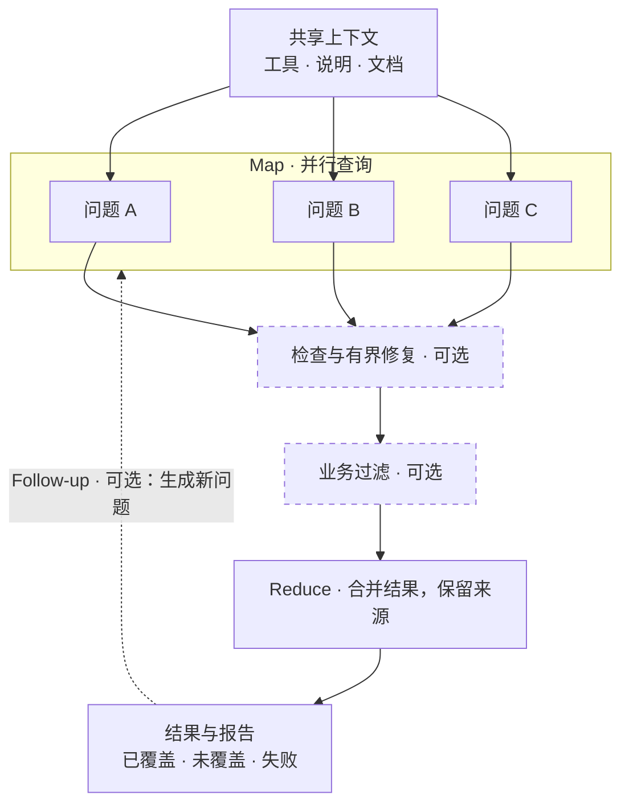
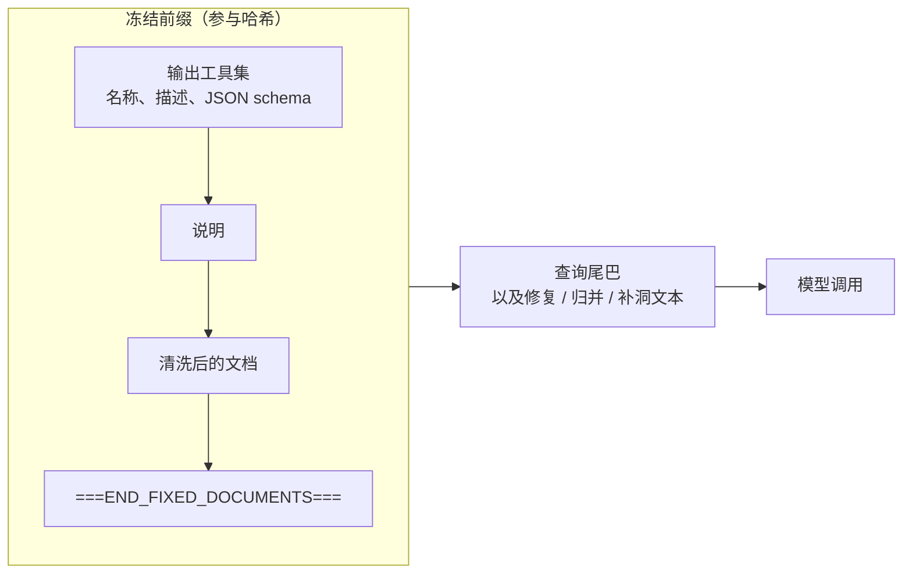
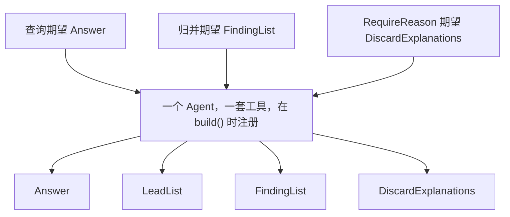

<p align="center">
  
</p>
<h1 align="center">forkreduce</h1>

forkreduce 是一个基于 [Pydantic AI](https://ai.pydantic.dev/) 的 Python 库，用来让很多次 LLM 查询共享同一份长上下文。


## 安装

需要 Python 3.11 或更高版本。

```bash
pip install "forkreduce[openai]"
```

Temporal 适配器是可选依赖：`pip install "forkreduce[temporal]"`。核心包不会导入它。

基础安装改用不带厂商 SDK 的 `pydantic-ai-slim`。OpenAI 兼容 helper 使用 `[openai]`，需要完整 Pydantic AI 厂商依赖时使用 `[full]`。此前依赖传递安装获得其他厂商 SDK 的应用，须改装 `forkreduce[full]` 或显式安装所需 slim extra。未安装 OpenAI 时仍可导入核心和 TestModel；调用 helper 才抛带安装提示的 `ImportError`。依赖变更不影响哈希或默认执行行为。

本 checkout 的源码版本是 **0.2.0**，修改版本元数据不等于发布。发布前安装本 checkout 请使用 `pip install -e .` 或 `pip install -e ".[temporal]"`；上面的命令安装 PyPI 当前已发布版本。

## 快速开始

对同一份文档提两个问题（map），再把回答合并为保留来源的摘要（reduce）。这个示例会调用真实模型；请先配置 OpenAI 兼容接口的环境变量：

```bash
export OPENAI_API_KEY="your-api-key"
export OPENAI_MODEL="your-model-name"
# 使用自定义接口时可选：
# export OPENAI_BASE_URL="https://your-provider.example/v1"
```

```python
import asyncio
from pydantic import BaseModel
from forkreduce import Query, Traced, build, openai_compatible_model


class Answer(BaseModel):
    text: str


class Summary(Traced):
    text: str


async def main() -> None:
    session = build(
        openai_compatible_model(),
        documents="Eligible titles: Science Digest and River Almanac. Deadline: 30 April 2026.",
        instructions="Answer only from the document.",
        outputs=[Answer, Summary],
    )
    result = await (
        session.map([
            Query(id="titles", tail="Which titles are eligible?", output=Answer),
            Query(id="deadline", tail="What is the deadline?", output=Answer),
        ])
        .reduce(output=Summary, instructions="Combine both answers into one concise summary.")
        .run()
    )
    if result.merged is not None:
        print(result.merged.text)
    if result.failures:
        print(result.failures)


asyncio.run(main())
```

输出示例（具体措辞取决于模型）：

```text
Eligible titles are Science Digest and River Almanac; the deadline is 30 April 2026.
```

文档和说明只需在 `build()` 时提供；map 和 reduce 共享同一前缀，变化的只是查询尾部。两种输出类型都预先注册；`Summary` 继承 `Traced` 来保留输入来源，合并结果从 `result.merged` 读取。默认先完成第一个 map 查询预热，再并行执行其余查询。真实缓存命中取决于供应商。如需无密钥、离线运行，可看下面的 `TestModel` 示例。

## 完整流程示例

在查询后加上引用检查、有界修复、业务过滤和合并。`TestModel` 只生成测试数据，用于演示 API 流程，不代表真实模型的抽取效果。

下面这份公告是虚构的。Northbridge 不是真实城市，刊名和数量都是编的。

```python
import asyncio
from pydantic import BaseModel, Field
from pydantic_ai.models.test import TestModel

from forkreduce import (
    CITATION_INSTRUCTIONS,
    Block,
    Citation,
    CitationCheck,
    CitationRepair,
    Document,
    Query,
    Traced,
    build,
)


class Answer(Citation):
    """从公告里抽出的一条事实。"""

    text: str


class Finding(Traced):
    topic: str
    summary: str
    source_ids: list[str] = Field(default_factory=list)


class FindingList(BaseModel):
    """归并后的结果。"""

    items: list[Finding]


notice = Document(
    doc_id="nb-lib-2026-per",
    title="Northbridge Public Library 2026 periodical subscription notice",
    blocks=[
        Block(block_id="titles", text="Eligible titles are the Northbridge Science Digest and the River Almanac."),
        Block(block_id="deadline", text="Offers must reach the front desk by 30 April 2026."),
    ],
)


async def main() -> None:
    # TestModel 不走网络。生产环境传入任意 pydantic-ai Model。
    session = build(
        TestModel(custom_output_args={"text": "see notice", "quote": "Eligible titles", "block_id": "titles"}),
        documents=notice,
        instructions="Answer only from the notice. " + CITATION_INSTRUCTIONS,
        outputs=[Answer, FindingList],
    )
    result = await (
        session.map([Query(tail="Which titles are eligible?", output=Answer, id="titles")])
        .check(CitationCheck(), repair=CitationRepair(max_rounds=2))
        .filter(lambda item: bool(item.quote))
        .reduce(output=FindingList, instructions="Merge the cited facts.")
        .run()
    )
    print(result.failures, result.cache_hit_rate)


asyncio.run(main())
```

`examples/run_offline.py` 是更完整的脚本：用 `FunctionModel` 走完 map、引用检查、覆盖策略和补洞，文档仍是同一份虚构公告。

## 动机

一份长文档配一个短问题，在问题很多的时候是很差的工作单位。每次都把文档再发一遍，输入 token 会重复计费，答案之间也没有统一的结构和出处。

前缀缓存改变的是成本形状。能缓存稳定前缀的供应商，对已经见过的 token 会便宜很多，也更快。前提是前缀逐字节稳定：同一套工具、同一段说明、同一份文档，变化的只有尾巴。forkreduce 负责把这个前缀冻住，并给周围的 map/reduce 步骤一个落点。

框架不理解业务。它不会认定“少了截止日期就是失败”，也不会自己丢掉一条引用检查失败的结果。它只报告事实，并执行你的策略返回的动作。

## 概念

| 部分 | 是什么 |
| --- | --- |
| **Session** | `build()` 得到。持有冻结前缀、输出类型、模型和执行策略。 |
| **Prefix** | 说明 + 清洗后的文档 + 结束标记，以及（tools 模式下的）工具集。哈希用作缓存身份。 |
| **Query** | 一条尾巴、期望的输出类型，以及可选的消息历史，用来延续一条分支。 |
| **Map** | 同一 session 上的多个查询。第一批可以先预热缓存，再放开并发。 |
| **Check / repair** | 检查只报告问题。修复可以延续同一条分支，代码只把允许的字段抄回去。 |
| **Filter** | 你的谓词。没通过的输出留在本次运行里，但不进入 reduce。 |
| **Reduce** | 在同一前缀上的一次或多次查询。条目带 `source_ids`。覆盖策略决定缺口怎么处理。 |
| **Follow-up** | 轮次之间的钩子。内置的 `GapFill` 会问还缺什么，再变成下一轮 map。 |

### 查询与归并流程



### 缓存前缀里有什么



`prompted` 模式下工具列表是空的。期望类型的 schema 追加在尾巴上，因此不属于前缀。

### 工具集



凡是之后会用到的输出类型，都要事先注册。如果策略可能要求解释，就把 `DiscardExplanations` 一并放进去。未注册的类型会在任何模型调用之前抛出 `UnregisteredOutputError`。tools 模式下，模型如果调用了另一个已注册工具，算校验失败，会重试。

## 按概念看 API

### Session 与 `build`

```python
session = build(
    model,                          # 任意 pydantic-ai Model
    documents=notice,               # str、字符串序列、Block、Document，或它们的序列
    instructions="...",
    outputs=[Answer, FindingList],  # 互不相同的 BaseModel 子类；工具名是类名
    output_mode="auto",             # 默认；也可显式指定 "tools" / "prompted"
    policy=Policy(concurrency=8, retries=2),
    warmup=True,
    executor=None,                  # 默认 LocalExecutor(policy)
    model_settings={"temperature": 0},  # 每次调用都带上
)
```

`session.prefix_hash` 是规范 JSON 的 SHA-256：版本、**实际解析的**输出模式、说明、清洗后的文档，以及工具名称、描述和 schema。相同内容重建 hash 不变；修改 schema、说明或文档会改变 hash。算法未改变：默认 `"auto"` 解析为 tools 保留旧 tools hash，解析为 prompted 则改变旧默认 hash；显式 tools/prompted hash 稳定，hash 中没有 `"auto"` 标记。

`build()` 默认 `output_mode="auto"`：解析后的 profile 和有效设置支持**强制输出工具调用**才选 tools，否则选 prompted JSON，仍按同一已注册 Pydantic 类型校验。`session.output_mode` 保留请求模式（`"auto"`、`"tools"`、`"prompted"`），`session.resolved_output_mode` 记录实际 `"tools"` 或 `"prompted"`。真实 `QueryResult`（包括失败、合并后的 reduce 结果）均记录 `resolved_output_mode`；`None` 仅是旧数据/手动构造默认值。这是在 build 时选择能力，不是请求失败后的回退。tools 不会悄悄接受文本或在响应后切换模式。prompted 下 schema 仍参与 hash，但 schema JSON 只放在查询尾部，不在共享提示前缀里。

显式模式被保留。显式 tools 缺少有效强制调用能力时默认发出 `UnforcedToolsWarning`；`on_unforced_tools="error"` 抛出 `UnforcedToolsError`，`"ignore"` 关闭诊断，都不会增加供应商能力。策略适用于 build 及查询设置改变能力时。auto session 的 `Query.model_settings` 若会切换实际模式，在预留预算或供应商调用前抛出 `OutputModeConflictError`；请用这些设置新建 session。模型默认值、build 设置、查询覆盖依次浅合并；查询 `extra_body` 整体替换 session 值。

限制可能来自**模型/供应商 API**，尤其 thinking 模式，而不是网关。[MiMo API 文档](https://mimo.mi.com/docs/en-US/api/chat/openai-api) 说明非 `auto` 的 `tool_choice` 被移除，仍按 `auto` 执行；[DeepSeek issue #1376](https://github.com/deepseek-ai/DeepSeek-V3/issues/1376) 报告 thinking 开启时强制调用返回 HTTP 400。[Pydantic AI PR #7450](https://github.com/pydantic/pydantic-ai/pull/7450) 说明按请求判断及隐式降级为 `auto`。不能据此推断所有模型/端点相同；自定义端点应配置准确 profile，`supports_tools=True` 不保证强制输出。

Pydantic AI 2.61 的以下公共 `ModelProfile` 字段均存在：

| 字段 | 默认值 | 含义 |
| --- | --- | --- |
| `supports_tools` | `True` | 能否使用工具。 |
| `supports_forced_tool_choice` | `True` | 支持 required/指定名称强制调用；false 时 SDK 隐式强制可降为 auto，显式强制抛 SDK `UserError`。 |
| `supports_forced_tool_choice_with_thinking` | `True` | thinking 时是否支持强制调用。 |
| `thinking_enabled_by_default` | `False` | 无覆盖设置时默认 thinking，不表示不能关闭。 |
| `supports_thinking` | `False` | 支持统一 thinking 配置；false 时 SDK 忽略统一 `thinking`。 |
| `thinking_always_enabled` | `False` | thinking 不可关闭，蕴含 thinking 支持；`thinking=False` 只选最低可接受 effort。 |
| `forced_tool_choice_disables_thinking` | `False` | 强制调用会禁用 thinking；thinking 活跃时 SDK 避免隐式强制输出工具调用。 |

`default_structured_output_mode="tool"` 是 SDK 偏好，不是能力保证；forkreduce 的 auto 只选 tools/prompted，不选 native 结构化输出。

实际规则：须同时支持 tools 和强制调用；thinking 活跃时还须 `supports_forced_tool_choice_with_thinking=True` 且 `forced_tool_choice_disables_thinking=False`。`thinking_always_enabled` 始终优先。供应商控制优先于统一 `thinking`：`openai_reasoning_effort` / `extra_body.reasoning_effort`（none 关闭）；`anthropic_thinking.type` / `extra_body.thinking.type`（enabled/adaptive 开启、disabled 关闭）；布尔 `extra_body.chat_template_kwargs.enable_thinking`（也支持顶层 `chat_template_kwargs`）；`google_thinking_config.thinking_budget`（0 关闭，其余包括 -1 开启）或 `thinking_level`（minimal/low/medium/high 均开启）。冲突时保守视为开启。否则仅在 `supports_thinking=True` 时采纳统一设置，再回退 `thinking_enabled_by_default`。未知的非 `None` thinking/reasoning 形状设置（包括已知控制的无效格式）在 auto 下抛出错误码为 `unknown_thinking_control` 的 `ForkReduceError`；显式 tools 视为无法保证强制调用并应用诊断策略，显式 prompted 保持有效。仅控制显示的 `include_thoughts`、`openai_reasoning_summary`、`openai_reasoning_generate_summary` 不开启 thinking。不按模型名猜测。

只有 thinking 可能改变强制调用能力时才检查这些控制：不支持 tools 或强制调用时，auto 直接选 prompted；支持 thinking 下强制调用且不会禁用 thinking 时，直接选 tools。这些无条件 profile 不会因无关的未知 thinking 控制报错；上述未知控制错误和显式 tools 的保守诊断仅适用于条件性 profile。

给推理模型留足输出余量：供应商的 completion 上限可能同时计算推理 token 和可见答案。`max_tokens` 太小，可能还没生成任何 JSON 或工具参数就已经耗尽。可以给 `build()` 传 `model_settings={"max_tokens": 8192}`，或给 `openai_compatible_model()` 传 `max_tokens=8192`，再按工作负载和供应商调整；8,192 只是示例，不保证不会截断，也不是账单上限。不要未经核实就假设网关支持 reasoning-effort 控制。

[MiMo 深度思考指南](https://mimo.mi.com/docs/en-US/quick-start/usage-guide/text-generation/deep-thinking) 说明其列出的 thinking 模型忽略请求的 `temperature`/`top_p`，固定使用 `1.0`/`0.95`；即使请求 `temperature=0` 也不能保证确定性输出。

`documents` 可以是一个字符串（单个块，id 为 `b1`）、一串字符串（`b1`、`b2`……），或 `Block` / `Document`。渲染和哈希之前会去掉控制字符。渲染结果以单独一行 `===END_FIXED_DOCUMENTS===` 结束。

`Block.meta` 会保存下来，默认不渲染，因此已有的前缀哈希不变。需要时用 `meta_keys`（按给出的键顺序渲染）或 `meta_renderer`（一个可调用对象）。渲染出来的 meta 属于前缀，也会进入哈希。两者只能传一个。

```python
session = build(
    model,
    documents=Document(
        doc_id="notice",
        blocks=[Block(block_id="b1", text="Hours are 9 to 5.", meta={"page": "3"})],
    ),
    instructions="Answer from the notice.",
    outputs=[Answer],
    meta_keys=["page"],  # 在块下方写入 [meta {"page":"3"}]
)
```

### Query 与 QueryResult

```python
query = Query(
    tail="Which titles are eligible?",
    output=Answer,          # 必须已注册
    id="titles",            # 省略时分配 q1、q2……
    history=None,           # None 从前缀开始；传入 previous.messages 则延续该分支
    meta={},
    round=0,
    model_settings={"temperature": 0.2},  # 只覆盖这一次调用的 session 设置
)
result = await session.ask(query)
# 或
results = await session.fork([query, other])
```

`QueryResult` 字段：

| 字段 | 含义 |
| --- | --- |
| `query_id` | 查询 id。 |
| `output` | 解析后的模型；失败时为 `None`。 |
| `messages` | 整条分支的记录（`all_messages()`），可以接着用。 |
| `prefix_hash` | 这次调用使用的 session 哈希。 |
| `usage` | 这条结果的 pydantic-ai `RunUsage`，含重试。 |
| `cache_hit_tokens` | 优先 `cache_read_tokens`；它为 0 时用 `details["prompt_cache_hit_tokens"]`。 |
| `attempts` | 这条结果打了多少次模型。 |
| `failure` | `Failure`，或 `None`。 |
| `round` | 计划轮次。`Plan.run` 里从 1 开始。 |
| `elapsed_ms` | 各次尝试的墙钟时间之和。 |
| `needs_review` | 修复用尽且策略要求保留并打标时为真。 |
| `dropped` | 留在本次运行中，但不进入 reduce。 |
| `check_failures` | 检查仍然报告的问题。 |

如果传入的 `history` 不是以渲染后的文档开头，会发出 `PrefixMismatchWarning`，调用仍会执行。框架不去猜你是不是想开一条新分支。

`session.map(queries)` 返回惰性的 `Plan`。`session.reduce(...)` 立刻做一次归并，返回 `ReduceOutcome`。

### 检查与修复

`CitationCheck` 会遍历嵌套的模型和列表。对每一对 `quote` / `block_id`（这是默认字段名）报告：

* `empty_quote` 或 `empty_block_id`
* `unknown_block`：id 不在本次 session 的文档里
* `quote_not_found`：把空白折叠之后，引用不是该块正文的子串

比较区分大小写。

`Citation` 是可复用的 Pydantic 模型，`quote` 和 `block_id` 字段都带说明。可以放进列表，也可以像上面的例子一样继承后添加答案字段。每条引文必须是完整包含在所引用单块内的连续片段；仅在文档其他位置出现，不代表该块支持这条引文。证据跨块时，应拆成各自带块 ID 的多条引用，不能把多个块拼成一条引文。

需要模型输出引用时，可把显式启用的 `CITATION_INSTRUCTIONS` 字符串追加到 session 说明中。框架不会向无关 session 注入这些说明；schema 和说明也不能替代 `CitationCheck`。采用 `Citation` 会改变已注册的输出 schema，因此改变 `prefix_hash`；追加说明也会改变冻结提示和哈希。保留原有自定义 schema 和说明的调用，哈希不变。归并和修复的新指引仅改变查询尾部，不改变冻结前缀或哈希。

`CitationRepair(max_rounds=2, allowed_fields=("quote", "block_id"))` 延续同一条分支，并要求同一个输出类型。修复说明会重申单块边界；默认字段限制下，应缩短引文或纠正块 ID，不能通过添加、拆分输出条目来修复。无论模型返回什么，`apply` 都会深拷贝原对象，只在每个失败路径上抄回允许的字段。其他字段保持原样。没有单独的修复 schema，工具集因此不会变。

```python
session.map(queries).check(
    CitationCheck(),
    repair=CitationRepair(max_rounds=2),
    on_failure="needs_review",  # 或 "drop"、"fail"
)
```

修复停止后仍然失败时，`on_failure` 覆盖 `Policy.repair_failure`：

* `needs_review`：保留输出，并标上 `needs_review`
* `drop`：不进入 reduce，但仍留在本次运行里
* `fail`：记一条永久性失败，跳过 reduce，也不再开后续轮次

默认是 `needs_review`。

自定义检查是可调用对象 `(output, *, documents) -> list[CheckFailure]`。自定义修复实现 `max_rounds`、`build_query` 和 `apply`。

### 过滤

```python
.filter(lambda item: bool(item.quote))
```

多个谓词按 AND 组合。被拒绝的输出仍在 `RunResult.results` 里，只是不传给 reduce。框架不提供确定性的归并器，过滤是业务自己的钩子。

### 语义归并与覆盖

归并就是同一 session 上的普通查询，所以命中同一前缀。尾巴把每条输入写成 `id: ...` 加 JSON，并显式列出允许使用的来源 ID。`source_ids` 必须标识这些输入条目（map 结果使用查询／fork ID），不能使用输入内容里的文档 ID 或块 ID。应以当前批次的输入 ID 替换原有 `source_ids`，不要混入证据地址。

如果输入带有字符串 `question_id` 字段，包括嵌套模型、字典、列表和元组，尾巴还会逐题列出允许使用的输入 ID，例如 `{"opening": ["fork:0"], "closing": ["fork:1"]}`。同一问题出现多次时会收集所有匹配的输入 ID。这是通用提示指引，不是业务专属校验；下面的来源检查规则不变。没有问题 ID 的通用输入仍然可用，树形归并的各批次使用当前别名 ID，最终再展开。

```python
class ExplainUncovered:
    def decide(self, report):
        if report.uncovered:
            return RequireReason(tuple(report.uncovered))
        return Accept()

session.map(queries).reduce(
    output=FindingList,                 # 已注册，且条目带 source_ids
    instructions="Merge the notice into one list.",
    coverage=ExplainUncovered(),
    max_batch=200,                      # 更多输入会变成一棵归并树
    max_rounds=3,                       # 覆盖 Retry 的上限
)
```

默认检查 `Provenance` 要求每条带来源的记录引用真实存在的 id。未知 id 进 `invalid_refs`。没有 `source_ids` 的条目进 `untraced`。这两种情况会在批次内重试，次数不超过 `Policy.retries`，并附上“只引用给定 id”的提示。模型调用本身失败不会在这里再问一遍，执行器已经重试过了。

`ReduceReport` 始终包含：

| 字段 | 含义 |
| --- | --- |
| `covered` | 出现在某个 `source_ids` 里的输入 id。 |
| `uncovered` | 没有出现的输入 id。策略接受时也保留。 |
| `invalid_refs` | 引用了不在输入里的 id。 |
| `untraced` | 没有声明 source id 的条目的 JSON 路径。 |
| `reasons` | `RequireReason` 之后的 `DiscardExplanation`。 |
| `kind` | 默认 `"reduce"`。 |

`CoveragePolicy.decide(report)` 返回一个动作，由框架执行：

| 动作 | 效果 |
| --- | --- |
| `Accept()` | 保留归并结果。未覆盖的 id 仍在报告上。这是默认策略（`AcceptUncovered`）。 |
| `RequireReason(items)` | 延续归并分支，要求输出 `DiscardExplanations`。该类型必须已经注册。 |
| `Retry(items, hint)` | 再归并一次。`items` 为空则重试全部原始 id，否则只重试这些 id。`hint` 追加在尾巴上。 |
| `Fail(reason)` | 停止。`ReduceOutcome.fatal` 为真，原因被保存。 |

`Drop` 不是归并动作。它用于引用失败的处理和补洞线索策略。

输入超过 `max_batch` 时按树归并。中间节点使用别名 id。覆盖策略运行之前，这些别名会在返回对象上展开成原始 id。消息历史里仍是模型原始的工具参数，其中可能还是别名。

`Traced` 是带 `source_ids: list[str]` 的 pydantic 基类。可以继承它，也可以自己声明 `source_ids`。子类如果重新声明该字段，请给默认值。来源检查仍把缺失或空列表视为未追溯。

### Follow-up 与补洞

```python
def more(state, session):
    if state.round >= 2:
        return []
    return [Query(tail="What is still missing?", output=Answer)]

session.map(queries).reduce(output=FindingList).followup(more, max_rounds=2)
```

`followup(fn, max_rounds=2)` 在每一轮之后调用 `fn(state, session)`，最后一轮不再调用。`max_rounds` 把第一轮算进去。返回空列表就结束。不挂 `followup` 时，计划只跑一轮。

`RoundState` 有 `round`、`results`、`outputs`、`merged`、`report`，以及钩子自己产生的 `failures` 和 `side_results`。声明了 `round` 字段的对象，在轮次大于 0 时会被盖上当前 map 轮次。

`GapFill` 是内置策略：

```python
gap = GapFill(
    lead_output=LeadList,          # 已注册；读取 .leads 或 .items
    item_output=Answer,            # 已注册；每条新线索一个查询
    scopes=[Scope("delivery", "how a sealed offer is delivered")],
    instructions="Report blocks in this scope that the merge does not already cite.",
)
```

每个 scope 在同一前缀上问一次。位置（默认 `block_id`）已经出现在归并结果里的线索会被跳过。`LeadPolicy` 看到 `LeadReport` 后可以 `Accept`、按位置 `Drop`，或 `Fail`。默认是 `AcceptLeads`。

### 输出校验错误回喂

`Policy(output_feedback_retries=0)` 保持单次请求行为。启用 `Policy(output_feedback_retries=1)` 并在 `build(..., output_validator=validate_output)` 传入校验器，可在同一题历史上有界续写。校验器接收解析后的输出，支持同步或异步，返回接受/替换后的值，通过 Pydantic AI `ModelRetry` 将错误回喂模型。schema 与跨字段校验失败也走同一机制。回喂不会重建共享前缀：instructions、文档字节、工具集合不变，仅给本题历史追加 retry 消息。

`QueryResult.feedback_retries_used` 和 `meta["feedback_retries_used"]` 记录实际回喂次数；本地外层重试会累加该数。每次实际请求（含回喂）之前都检查请求数/token 预算。`Policy.retries` 仍是独立的外层重试上限。回喂和校验器不改变 `prefix_hash`，非默认配置会改变 Temporal execution fingerprint。

Temporal activity 使用 worker 登记或 factory 构建的 session，不序列化函数。`FrozenPrefix.output_feedback_retries` 保存数值策略；factory 应以 `Policy(output_feedback_retries=frozen.output_feedback_retries)` 恢复，并安装 worker 本地校验器。activity 成功/安全失败结果记录最后一次 activity attempt 的 `feedback_retries_used`，不猜测跨 Temporal attempt 的总数。校验错误会发送给模型，勿将敏感内容放入错误信息。

### 并发、重试、预算

```python
Policy(
    concurrency=8,             # 模型调用外的信号量
    retries=2,                 # 第一次之外的额外次数
    retry_backoff=0.5,         # 秒；传输错误每次加倍，不超过 max_backoff
    max_backoff=8.0,
    budget=Budget(
        max_requests=100,
        max_input_tokens=None,
        max_output_tokens=None,
        max_total_tokens=None,
    ),
    repair_failure="needs_review",
    budget_policy=None,        # callable(BudgetReport) -> Accept | Fail | ...
    context_limit=None,        # 单次调用的上下文窗口（估算 token）；None 表示不做本地警告
    context_reserve=None,      # 前缀预留；None 表示 min(limit, max(4096, limit // 4))
)
```

失败分类：

| 种类 | 例子 | 行为 |
| --- | --- | --- |
| `validation` | 工具用错、schema 不符、`UnexpectedModelBehavior`、`UsageLimitExceeded` | 立即重试，直到上限。 |
| `transport` | HTTP 408、409、425、429 和 5xx；超时；连接错误 | 指数退避后重试。 |
| `permanent` | 其他 4xx、`UserError`、供应商报出的 `context_overflow`、未识别的异常 | 不重试，挂在结果上返回。 |
| `budget` | 上限在这次调用之前已经用尽 | 不重试。 |

每次模型调用都使用 pydantic-ai 的 `retries=0` 和 `UsageLimits(request_limit=1)`。重试循环由 forkreduce 掌握，校验错误不会变成一次看不见的内部重试。失败的调用不会从本次运行里消失。

`warmup=True`（默认）会让第一批 `fork` / `map` 的第一个查询先跑完，再启动其余查询，好让供应商写下前缀。没有额外的空请求。同一 session 之后的 fork 完全并发。单独的 `ask` 不会预热。

token 预算按 session 累计。只要设置了任何 token 上限，模型调用就会串行，即使 `concurrency` 大于 1。只有已经完成的调用把上限用尽时，下一次才会被拒绝。正在飞的那一次如果跨过上限，会被放行，因为大小要等它返回才知道，而且在把这次用量记下来之前不会再开始别的调用。因此最多只超出这一次，而不是每个并发槽各超出一次。只限制请求次数时仍然并发：每次调用在发出之前占一个请求名额。在发出之前就被拦住的调用，`attempts` 为 0，也不占请求名额。

校验失败的响应仍然会计费。token 用量从捕获到的模型响应里读出来，记入预算和 `QueryResult.usage`。传输失败如果根本没有响应，就没有 token 可记；已经占下的请求名额仍然算数。`budget_policy` 可以返回 `Accept` 强制放行，或返回 `Fail` 并带上你的原因。默认是拦住。

### 上下文上限

`Policy.context_limit` 是模型的上下文窗口，单位是估算 token，和上面按 session 累计的预算不是一回事。估算方法是每 4 个字符算 1 个 token，向上取整，计入说明、工具 schema、文档（或延续分支的历史）以及查询尾巴。这不是供应商自己的分词器。供应商的判断才算数：本地估算不会拦住 `build()`、`ask`、`fork` 或 `map`，提示词也不会被截断或拆块。

设置了上限且估算超过可用窗口时，forkreduce 发出 `ContextEstimateWarning`（一种 `UserWarning`），并在 `forkreduce.context` 日志器上写同一条消息，然后照常发送请求。

* 在 `build()`，冻结前缀在 `prefix_estimate > context_limit - reserve` 时警告。警告记在 `Session.context_warning`。
* 在 `ask` / `fork` / `map`，整次估算（前缀或历史，加上尾巴）大于 `context_limit` 时，该查询警告。警告记在 `QueryResult.context_warning`，并列入 `RunResult.context_warnings`。前缀警告也会抄到 `RunResult.context_warning`。

每条警告都带 `estimated_tokens`、`limit` 和 `reserve`。等于上限算在窗口内。`context_limit` 为 `None` 时不做本地警告，即使设置了 `context_reserve`。

`context_reserve` 是留给前缀之外的余量，单位同样是估算 token。默认 `None` 表示 `min(context_limit, max(4096, context_limit // 4))`。4096 个 token 够 8k 到 16k 窗口上的一条真实尾巴和一份结构化回答（8k 的一半，16k 的四分之一）。窗口更大时，上限的四分之一是两者里更大的那个，前缀挤掉单次查询的空间时仍会警告。这个值不会超过 `context_limit`，所以小于 4096 的窗口把整个窗口都当成余量，任何非空前缀估算都会警告，而且不会变成负数。设成整数（包括 `0`）就替换这个公式。`0` 表示只有前缀本身超过整个窗口时才警告前缀。请求警告不再减一次 reserve，因为那次估算已经包含尾巴；reserve 仍会记在警告上。

供应商因为上下文长度拒绝这次提示时（HTTP 400，正文写明超过最大上下文），才是不可重试的 `Failure`，`code` 为 `context_overflow`，`detail["where"]` 为 `"provider"`。正文里如果带了数字，消息用的是供应商报出的数字（`reported 9000 tokens exceeds context limit 8192`）。按块 map 再 reduce 不是 v0.1 的行为。

`RunResult.usage` 是 `UsageSummary`：请求数、输入和输出 token、缓存命中 token、耗时毫秒、按轮次的分解，以及 `cache_hit_rate`（`cache_hit_tokens / input_tokens`）。map 和它的修复会计在同一条 map `QueryResult` 上，避免算两次。归并按单次调用累加，不再把已经加总的结果加一遍。

### 延续一条分支

```python
first = await session.ask(Query(tail="Which titles?", output=Answer, id="titles"))
follow = await session.ask(Query(
    tail="Now quote the deadline as well.",
    output=Answer,
    id="titles-more",
    history=first.messages,
))
```

`history` 是整条分支，包含前缀。修复和 `RequireReason` 用的是同一机制。

### 模型

传入任意 pydantic-ai `Model`，包括 `TestModel` 和 `FunctionModel`。OpenAI 兼容服务：

```python
from forkreduce import openai_compatible_model

model = openai_compatible_model()  # OPENAI_MODEL 或 FORKREDUCE_MODEL、OPENAI_API_KEY、OPENAI_BASE_URL

model = openai_compatible_model(
    "local-model",
    base_url="http://127.0.0.1:8000/v1",
    timeout=30,
    temperature=0,
    profile={"supports_tools": True},
    extra_body={"chat_template_kwargs": {"enable_thinking": False}},
)
```

OpenAI 客户端以 `max_retries=0` 构造。重试由 forkreduce 做。`timeout`、`profile`、`extra_body` 和常用采样参数都是 pydantic-ai 的模型设置。`settings={...}` 可以传入其他 `ModelSettings` 键；同名的显式参数优先。`build(..., model_settings=...)` 让每次调用都带上这些设置，`Query.model_settings` 只覆盖这一次的对应键。`extra_body` 是整段替换，不会按字段合并。

### Temporal（可选）

安装 `forkreduce[temporal]`；核心导入不加载 `temporalio`。每个 `forkreduce.run_query` activity 只调用一次 `Session.run_once`，重试由 Temporal 负责：校验/传输失败可重试，永久错误/预算耗尽不可重试。默认不变：一个 `forkreduce.map_queries` workflow、5 分钟 start-to-close、不设置 heartbeat timeout、总尝试次数为 `Policy.retries + 1`。

#### 配置与插件 worker

`ActivityOptions` 的时长单位是**秒**。可在 `build` 设置，在单个 payload 的 `activity_options` 覆盖，或在 `MapQueriesInput.activity_options` 为整个工作流整对象替换。未指定的重试字段继承 payload 内的策略预算/退避；`maximum_attempts` 包含首次执行。**2 次尝试 / 3 分钟 / 30 秒心跳**配置：

```python
from forkreduce import ActivityOptions, build
from forkreduce.contrib.temporal import (
    MapQueriesInput, MapQueriesWorkflow, QueryBatchWorkflow,
    query_activity_input, register_session, run_query_activity,
)
from pydantic_ai.durable_exec.temporal import PydanticAIPlugin
from temporalio.client import Client
from temporalio.worker import Worker

session = build(
    model, documents=document, instructions="Answer from the document.", outputs=[Answer],
    activity_options=ActivityOptions(
        start_to_close=180, heartbeat_timeout=30, maximum_attempts=2,
        # schedule_to_close=600, retry_backoff=1, max_backoff=8, backoff_coefficient=2,
    ),
)
register_session(session)  # 每个 activity worker 进程都要登记
client = await Client.connect("localhost:7233", plugins=[PydanticAIPlugin()])
async with Worker(
    client, task_queue="extraction",
    workflows=[MapQueriesWorkflow, QueryBatchWorkflow],
    activities=[run_query_activity],  # 继承 client 的插件
):
    results = await client.execute_workflow(
        MapQueriesWorkflow.run,
        [query_activity_input(session, query_id="q1", tail="What is required?", output_name="Answer")],
        id="extraction-run-1", task_queue="extraction",
    )
```

Temporal 默认 converter 和 `PydanticAIPlugin` 安装的 `PydanticAIPayloadConverter` 均有离线 workflow/replay 覆盖。forkreduce 的逐查询 activity 可以与官方 `TemporalDurability` agent 在同一 worker 共存；照常登记其 agent/workflow，不要再给这些 activity 外包一层模型重试循环。使用官方集成时安装 Pydantic AI 的 `[temporal]` extra。默认 converter 的 worker 请设置 `workflow_runner=SandboxedWorkflowRunner(restrictions=SandboxRestrictions.default.with_passthrough_modules("forkreduce", "pydantic_ai"))`；两个类都来自 `temporalio.worker.workflow_sandbox`，避免在沙箱重新导入模型依赖。

设置 heartbeat timeout 后，单个定期心跳协程覆盖整个异步 query activity：前缀及续问历史读取、异步 session factory 构建、模型 await、transcript/output 写入。仅在 activity 完成、失败或取消时结束，慢存储不会在模型调用前后失去心跳保护。这是存活信号，不代表业务进度。阻塞事件循环仍会阻塞心跳：CPU 工作放线程或独立 activity，并保留有限 start-to-close。LocalExecutor 不使用这些选项；它们不改变前缀字节/哈希。

登记仅对本进程有效。payload 只带哈希、问题尾巴、输出类型名、选项和可选单题 `model_settings`，不带模型实例或 Python 类。相同前缀登记不同模型/请求体设置/profile/policy 会抛出 `ForkReduceError`，替换前先 unregister。`timeout`/`extra_headers` 仍不计入指纹；设置必须能 JSON 序列化。`activity_id(prefix_hash, query_id)` 仍是 `forkreduce:{prefix_hash}:{query_id}`。单工作流内联续问仍可把前次 `messages_json` 传入 `history_json`。

#### 有界子工作流与引用传递

`MapQueriesInput(queries=payloads, batch_size=15, child_concurrency=4)` 启用有界子工作流；worker 必须同时登记 `MapQueriesWorkflow` 与 `QueryBatchWorkflow`。结果保持输入顺序。child ID 从父 workflow ID、prefix hash、batch index 推导，重放以及改变 run ID 的 workflow 重试均保持稳定；不同父 workflow ID 不碰撞。它不是供应商计费的 exactly-once 保证。

分批模式要求 `MessageStore`，返回 `messages_ref` 和 `output_ref`，不把 transcript 或结构化结果正文带回父历史。父历史与 transcript 大小无关，但问题尾巴、meta 和结果引用列表仍占用空间，须保持精简。分批续问必须用 `history_ref`，不能用内联 `history_json`。默认列表输入/单工作流模式仍支持小载荷内联。

`MessageStore` / `PrefixStore` 保留旧异步 `put(key, bytes)` / `get(ref)` 协议；新 `ContextMessageStore` 在两者上接受 keyword-only `context: StoreContext`。适配器先检测签名，绝不捕获 `TypeError` 后重复写入。生产应接所有 worker 共享的持久存储；`InMemoryMessageStore` 只适合单进程测试。

#### Worker 重启安全的接入示例

下面的 SQLite store 可跨本地 worker 重启保留引用；分布式 worker 应改用共享对象存储或数据库，确保每个 worker 都能读取同一引用。凭证和输出类始终留在应用进程内。`model`、`session`、`Answer`、`questions`、`client` 沿用上面的应用配置。

```python
import asyncio
import sqlite3
from pathlib import Path
from forkreduce.contrib.temporal import (
    StoreContext, delete_ref, freeze_prefix, set_default_session_factory,
    set_prefix_store, set_message_store,
)

class DurableStore:
    def __init__(self, path: str):
        self.path = path
        with sqlite3.connect(path) as db:
            db.execute("CREATE TABLE IF NOT EXISTS blobs (ref TEXT PRIMARY KEY, body BLOB)")

    def execute(self, sql, args):
        with sqlite3.connect(self.path) as db:
            return db.execute(sql, args).fetchone()

    async def put(self, key: str, payload: bytes, *, context: StoreContext) -> str:
        # 框架生成的 key 已包含转义后的 namespace 前缀。
        await asyncio.to_thread(self.execute, "INSERT OR REPLACE INTO blobs VALUES (?, ?)", (key, payload))
        return key

    async def get(self, ref: str, *, context: StoreContext) -> bytes:
        row = await asyncio.to_thread(self.execute, "SELECT body FROM blobs WHERE ref = ?", (ref,))
        if row is None:
            raise KeyError(ref)
        return row[0]

    async def delete(self, ref: str, *, context: StoreContext) -> None:
        await asyncio.to_thread(self.execute, "DELETE FROM blobs WHERE ref = ?", (ref,))
        # SQL DELETE 对不存在的 ref 不做操作，重复清理也是安全的。

store = DurableStore(str(Path("shared-blobs.sqlite")))
app_meta = {"ref_namespace": "demo-run", "schema_version": 1}
# client 或 prepare activity 内执行，不在 workflow 内冻结：
prefix_ref = await freeze_prefix(session, store, app_meta=app_meta)
payloads = [
    query_activity_input(
        session, query_id=f"q{i}", tail=question, output_name="Answer", prefix_ref=prefix_ref,
        ref_namespace="demo-run",
    )
    for i, question in enumerate(questions)
]

# 每个 worker 启动时配置，不需要恢复逐 prefix 的登记列表。
def restore(frozen):
    assert frozen.app_meta["schema_version"] == 1
    return build(
        model, documents=frozen.documents, instructions=frozen.instructions,
        outputs=[Answer], output_mode=frozen.output_mode,
        on_unforced_tools=frozen.on_unforced_tools,
    )

set_prefix_store(store)
set_message_store(store)
set_default_session_factory(restore)
# worker 同时登记两个 workflow 和 run_query_activity，并在运行期间提交：
results = await client.execute_workflow(
    MapQueriesWorkflow.run,
    MapQueriesInput(queries=payloads, batch_size=15, child_concurrency=4, on_query_failure="return"),
    id="extraction-run-2", task_queue="extraction",
)
for result in results:
    if result.failure_kind is not None:
        print(result.query_id, result.failure_kind, result.failure_message, result.attempts)
    else:
        context = StoreContext(kind="output", prefix_hash=result.prefix_hash, namespace="demo-run")
        answer = Answer.model_validate_json(await store.get(result.output_ref, context=context))
# 成功结果用 history_ref=result.messages_ref 续问。
# 仅在应用确认引用保留期结束后，显式清理：
# await delete_ref(store, ref, context=StoreContext(kind="prefix", prefix_hash=session.prefix_hash,
#                                                namespace="demo-run"))
```

`on_query_failure="raise"` 仍是默认，旧 list 调用不变，错误照常向上传播。`"return"` 保持输入顺序，成功/失败都用 `QueryActivityOutput`：失败带 `failure_kind`、`failure_type`、有界且不含载荷原文的 `failure_message` 和 `attempts`，不带 transcript/output 正文或引用。完整的 `failure_kind` 契约如下：
公开的 `Literal` 类型别名 `QueryFailureKind` 从 `forkreduce.contrib.temporal` 导出，取值为下表六种非 `None` 值；`None` 表示成功。

| `failure_kind` | 含义 |
| --- | --- |
| `retryable_exhausted` | Temporal 达到最大尝试次数后的可重试错误。 |
| `permanent` | 除预算耗尽外的不可重试 application 错误。 |
| `budget` | 应用预算耗尽。 |
| `timeout` | Temporal activity 超时。 |
| `cancelled` | activity 被取消，不是父 workflow 自身取消。 |
| `unknown` | 无法分类的错误，包括未识别的 application/activity 错误或失败的 child batch。 |

`failure_type` 仅在原始 `ApplicationError.type` 为 `validation`、`transport`、`permanent`、`budget`、`session_factory_missing`、`ref_namespace_mismatch` 之一时保留原值；其他类型均为 `None`，不输出任意异常文本或杜撰代码。例如 validation 重试耗尽是 `retryable_exhausted` / `validation`，缺少 factory 则是 `retryable_exhausted` / `session_factory_missing`。return 模式的 `ChildWorkflowError` 为该 batch 每个 query 生成 `unknown` / `batch_failed`，`attempts=0`；`batch_failed` 是额外允许的合成类型，不是原始 application 错误类型。父 workflow 自身取消始终向上传播，return 模式也不例外。attempts 记录已观察到的 activity 尝试数；`0` 表示没有次数信息（例如执行前超时），不是猜测配置上限。

失败记录的 `attempts` 统计 Temporal activity 尝试次数；成功记录仍保留原有 `Session.run_once` 的单次执行计数，本选项不重新定义成功结果字段。

查找顺序为显式登记的 session、prefix 精确 factory、`set_default_session_factory`；传 `None` 清除默认 factory。都缺失时抛可重试 `session_factory_missing`，仍受已配置重试预算约束，worker 补齐配置后可在后续 attempt 成功。快照损坏、重建/hash 不一致仍不可重试。
恢复场景建议使用 `ActivityOptions(maximum_attempts=5, retry_backoff=2, max_backoff=30, backoff_coefficient=2.0)`。设置尝试次数和可选 schedule-to-close 时，须给 worker 修复/重启留出足够恢复窗口；窗口关闭后，重试不能再挽救配置。

`freeze_prefix(..., app_meta=...)` 将 JSON 元数据复制进 `FrozenPrefix.app_meta`（旧快照默认 `{}`），限制为 **16 KiB compact UTF-8 JSON**，不参与 prefix hash、identity 或 execution fingerprint。仅放路由/schema 标识，**不要放密钥、正文或文档载荷**；factory 获得完整快照。

`StoreContext` 是 frozen、可序列化 dataclass，字段为 `workflow_id`、`run_id`、`parent_workflow_id`、`activity_id`、`query_id`、`round`、`attempt`、`kind`（`prefix/messages/output/history`）、`prefix_hash`、`namespace`。不可用的执行字段为 `None`。快照 `app_meta.ref_namespace` 记录 prefix 的存储位置；`query_activity_input` 不读取快照，也不会从不透明引用推断 namespace。首次 prefix 读取需要 namespace 路由时，须在 query 的 `meta.ref_namespace` 携带相同值，因为读取完成前拿不到快照元数据。显式 query namespace 与读出的快照不一致会被不可重试的 `ref_namespace_mismatch` 拒绝，不会静默切换路由。非空 namespace 经 URL 转义后加到框架 key 前；没有 namespace 时 key 原样保留。context 仅为路由元数据，不是鉴权边界。
可用 `query_activity_input(..., ref_namespace="demo-run")` 自动写入复制后的 query metadata。仅当 query 和快照的 namespace 都非空时要求相同；缺失或空 namespace 不触发 mismatch。

可选 `delete(ref, *, context)` 仅由应用显式调用 `delete_ref(store, ref, *, context)` 触发，兼容旧 `delete(ref)`。实现必须将删除不存在的引用（重复删除或从未创建的引用）作为成功的空操作，保留其他引用。不支持 delete 仍抛 `NotImplementedError`，其他存储错误不会被吞掉。context 应携带原引用的 kind、prefix hash 和 namespace。框架不会自动删除对象；应用负责保留到所有重试/续问结束。

`FrozenPrefix` 存文档、说明、渲染前缀与工具身份，不序列化可执行模型/schema 类。worker 会校验重建后的 prefix hash；须保持 schema/渲染配置一致。worker 启动时登记 factory，引用对象保留到重试/续问生命周期结束。最终结果与引用应持久化，已结束 workflow 的实时流不能当归档重放接口。编排存在不兼容变更时，排空在途执行或使用 worker versioning/新队列，并重放实际迁移所需历史；converter 测试不保证任意旧工作流代码在编排变更后仍能重放。
`FrozenPrefix.output_mode` 保留请求模式（包括 auto），`resolved_output_mode` 记录实际模式（旧快照可为 `None`），`on_unforced_tools` 保留诊断策略。factory 按上例恢复请求模式和策略，还须恢复相同 thinking 相关模型/session 设置。worker 校验实际模式及 prefix hash；能力或设置改变必须失败，不得悄悄恢复不同输出约定。模型/设置由 factory 管理，不将含传输凭据的设置序列化进快照。
factory 默认每个 activity attempt 调用一次，避免无意中跨工作流共享可变 session 预算。需要 worker 内复用时，factory 可返回应用显式管理的缓存 session，或调用 `register_session`；缓存同步、生命周期与预算范围由应用负责。


## 缓存注意事项

**Schema 固定。** 工具定义属于前缀。供应商会先渲染工具再渲染消息，forkreduce 也不会事后添加工具。新增输出类型、改字段名或改描述，都会改变 `prefix_hash`，于是所有查询都错过缓存，不只是尾巴变了的那一条。`Literal` 枚举最好留一个 `"other"` 之类的出口，避免以后为了一个意外取值去改 schema。

**控制字符。** 有的供应商会拒绝工具参数 JSON 里的原始控制字符。forkreduce 在渲染和哈希之前去掉除制表符、换行、回车以外的 C0 控制字符，以及 DEL。带空字节的文档和去掉空字节之后的文档，哈希相同。

**预热。** 第一次请求才会建立缓存项。`warmup=True` 让第一批的第一个请求先结束，再发其余请求。一整批同时发出去，可能每一次都错过缓存。

**缓存过期。** 供应商按自己的策略让前缀缓存失效（常见是空闲若干分钟，有的更长）。forkreduce 管不到这份缓存，也无法主动刷新。隔了很久的下一批可能先 miss、按全价计输入，然后再命中。哈希仍然能告诉你发出去的是不是同一前缀。

**历史。** 延续分支时，除了前缀，还会带上之前的问答。只要这些字节不变，前缀缓存（含之前的轮次）同样可以命中。时间戳和 run id 不参与前缀检查；检查比较的是渲染后的文档正文。

**Prompted 模式。** 实际解析为 prompted 的 session 不往 Agent 上挂工具。期望 schema 只追加在尾巴，不同查询可用不同已注册类型而不打掉前缀。tools 模式保持稳定工具列表；默认 auto 只在支持强制输出工具调用时选择它。

**采样和传输。** `temperature`、`top_p`、`max_tokens`、`seed`、惩罚项、`stop_sequences`、`timeout` 和 `extra_headers` 不改变冻结前缀，不会打掉供应商前缀缓存。`extra_body` 本身也不改变这些字节，但 thinking 设置可能在 build 时改变 auto 实际模式（从而改变 hash），查询覆盖不能切换模式。采样参数和 `extra_body` 会改变 JSON 请求体，Temporal 因此视不同值为不同执行，`register_session` 会拒绝。`timeout` 和 `extra_headers` 是传输选项，不进入该指纹。

**Profile 和块 meta。** 模型 `profile` 可能改变工具或 schema 在线路上的渲染方式。即便 `prefix_hash` 没变，供应商缓存仍可能 miss，所以解析后的 profile 会计入执行指纹。`Block.meta` 默认不渲染，除非传入 `meta_keys` 或 `meta_renderer`。一旦启用，meta 会写进文档正文，`prefix_hash` 和被缓存的前缀都会变。

## 常见问题

**归并必须和 map 用同一个输出类型吗？** 不用。它必须是 `build()` 时注册过的类型之一。map 和归可以不同。

**模型引用了一个我没给过的 id 怎么办？** 记在 `invalid_refs`。批次会重试到策略上限。如果模型一直编造 id，它们会留在报告上，默认策略仍然接受这次归并。更严的策略可以 `Fail` 或 `Retry`。

**未覆盖的条目会被删掉吗？** 不会。`Accept` 把它们留在 `ReduceReport.uncovered`。需要人看到舍弃原因时用 `RequireReason`。

**可以不走计划、直接归并吗？** 可以。`await session.reduce(items, output=FindingList, id_of=...)`。

**密钥放哪？** 只放在环境变量里，或传给 `openai_compatible_model` 的参数里。这个仓库没有 `.env`，也没有写死的密钥。

**核心会导入 Temporal 吗？** 不会。只 `import forkreduce` 的进程不会加载 `temporalio`。

## 开发与测试

从源码目录：

```bash
pip install -e ".[dev]"
ruff check src tests examples && ruff format --check src tests examples
mypy
pytest
```

0.2.0 开发验证组合：Pydantic AI 2.61.0 / OpenAI 3.37.0，配合 Temporal SDK 1.33.0 与 1.34.0。依赖范围仍为 `pydantic-ai>=2.57,<3` 和可选 `temporalio>=1.9`；官方插件另有自身 extra 要求。Temporal 测试启动真实 time-skipping server，只调用离线模型。无网络环境可设置 `TEMPORAL_TEST_SERVER=/path/to/temporal-test-server` 复用已有二进制，否则 SDK 会下载。

示例不需要密钥，完全离线：

```bash
python examples/run_offline.py
```

也可以对着 OpenAI 兼容接口跑。没设置 `OPENAI_API_KEY` 时进程会直接退出。

```bash
OPENAI_API_KEY=... OPENAI_MODEL=... OPENAI_BASE_URL=... python examples/run_live.py
```

模型名也可以用环境变量 `FORKREDUCE_MODEL`。

## 升级到 0.2.0

- 新默认 `output_mode="auto"` 在有效 profile 支持强制输出时保留旧 tools hash。强制调用不可用（包括 thinking 限制）时现在解析为 prompted，原先依赖 tools 默认值的用户会得到新 hash、旧缓存失效。schema/instructions 不变时显式 tools/prompted 的 hash 稳定；采用新引用 schema/instructions 也会改变 hash。完整兼容说明见 [Upgrade notes](CHANGELOG.md#upgrade-notes)。
- 切换 Temporal worker/converter 前，停止向旧队列提交新任务，让旧 worker 完成全部在途 workflow、child 和 activity，再一起切换 client/worker。引用对象保留到重试/续问生命周期结束。无法排空时，旧执行继续隔离在兼容队列/worker version，0.2.0 使用新队列或 worker version；迁移既有执行前重放代表性历史。
- 默认 converter 的 worker 和 Replayer 需使用 [Temporal 配方](#temporal可选) 中的 sandbox `workflow_runner` passthrough 配置；分批时同时登记 map/batch workflow。心跳现在也覆盖慢异步 store/factory，不代表可以阻塞事件循环执行 CPU 工作。

## 发布

PyPI 由 git tag 触发。`.github/workflows/release.yml` 构建 sdist 和 wheel，检查后通过 [Trusted Publishing](https://docs.pypi.org/trusted-publishers/) 上传。仓库里没有 PyPI token。发布者是 `426ai/forkreduce` 上名为 `pypi` 的环境，工作流文件是 `release.yml`。

1. 把 `pyproject.toml` 的 `version` 和 `src/forkreduce/__init__.py` 的 `__version__` 改成同一个版本。
2. 把这次改动提交到 `main`。
3. 给这个提交打 tag 并推送：

```bash
git tag vX.Y.Z
git push origin vX.Y.Z
```

tag 是 `v` 加上版本号：`0.2.0` 对应 `v0.2.0`。两者不一致时工作流失败。也可以在 Actions 里手动运行 Release，但只能选一个已经存在的 `v*` tag。仅做发版准备时，不得创建 tag 或运行该发布工作流。

## 路线图

v0.1.0 是第一次公开发布：一个 session、本地执行、引用检查与修复、带覆盖动作的语义归并、补洞、用量统计，以及可选的 Temporal activity 封装。

这一版没有、以后可以做的：

* 除引用之外的更多内置检查
* 持久的 `MessageStore`（对象存储或数据库）
* 流式的部分结果
* 把缓存预热从第一次真实查询里单独记一笔指标
* 在同一个 `Executor` 协议后面接第二种工作流运行时
* 可选的分块 map 再 reduce（提示词大于上下文窗口时）。本地估算只警告；供应商报出上下文超长时，这次调用仍然失败

## 许可证

MIT。见 [LICENSE](https://github.com/426ai/forkreduce/blob/main/LICENSE)。
