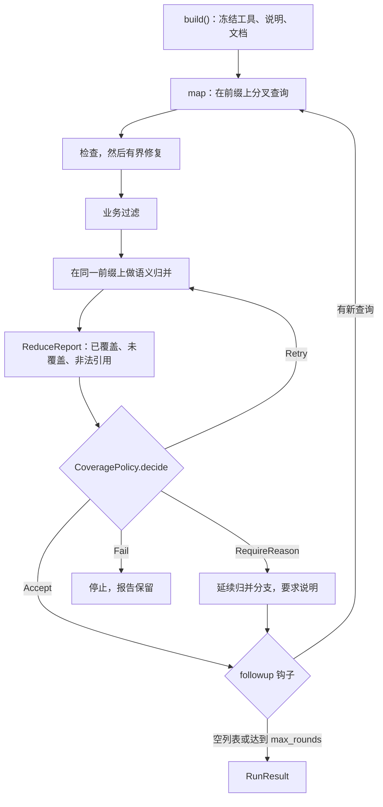
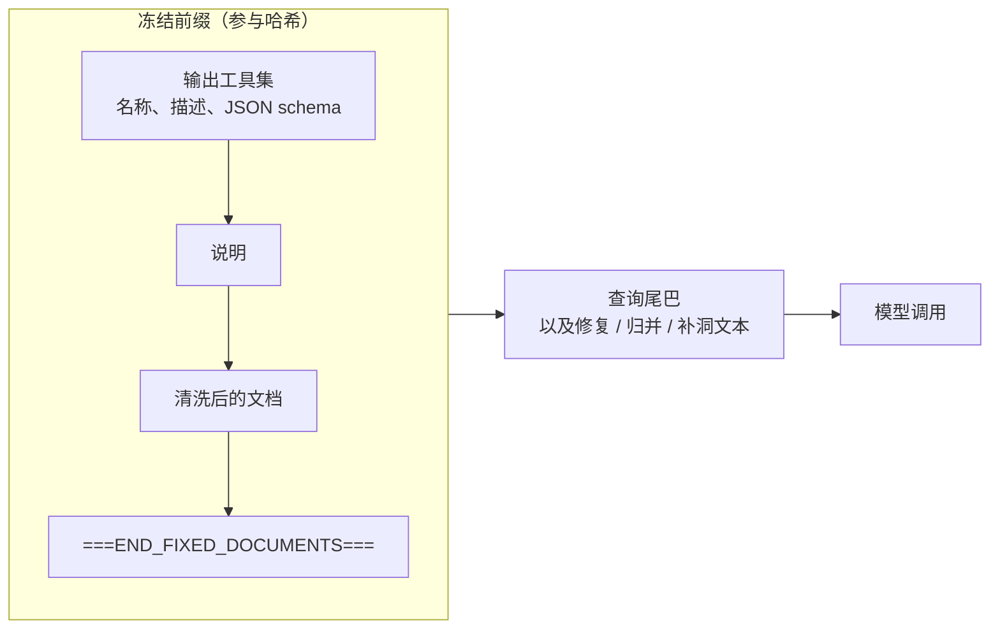
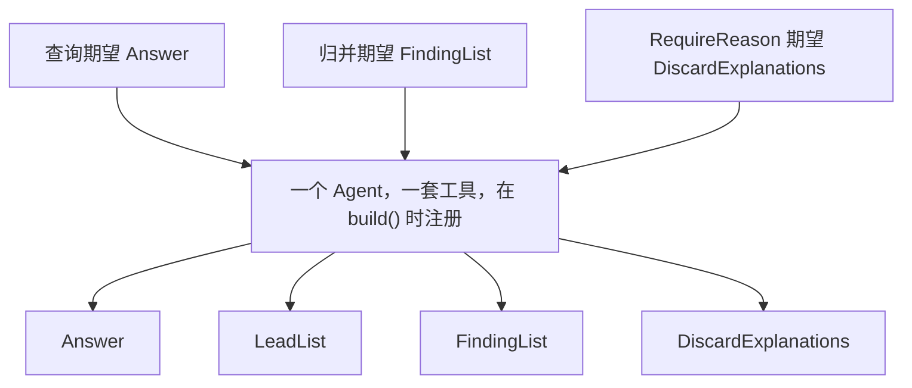

# forkreduce

forkreduce 是一个基于 [Pydantic AI](https://ai.pydantic.dev/) 的 Python 库，用来让很多次 LLM 查询共享同一份长上下文。

前缀只冻结一次：注册好的输出工具集、说明文字、文档。之后每个查询都是这段前缀上的短尾巴，这样供应商的前缀缓存才能命中。查询一起跑（map），检查可以在有限字段上修复，业务代码自己过滤，再由模型把留下来的结果合并（reduce），并且用 `source_ids` 标明出处。轮次之间可以挂 follow-up。被漏掉的条目、没通过的检查、预算用尽，都会留在报告上，不会悄悄丢掉。

```bash
pip install forkreduce
```

需要 Python 3.11 或更高版本。Temporal 适配器是可选额外依赖，核心包不会导入它。

```bash
pip install "forkreduce[temporal]"
```

## 动机

一份长文档配一个短问题，在问题很多的时候是很差的工作单位。每次都把文档再发一遍，输入 token 会重复计费，答案之间也没有统一的结构和出处。

前缀缓存改变的是成本形状。能缓存稳定前缀的供应商，对已经见过的 token 会便宜很多，也更快。前提是前缀逐字节稳定：同一套工具、同一段说明、同一份文档，变化的只有尾巴。forkreduce 负责把这个前缀冻住，并给周围的 map/reduce 步骤一个落点。

框架不理解业务。它不会认定“少了截止日期就是失败”，也不会自己丢掉一条引用检查失败的结果。它只报告事实，并执行你的策略返回的动作。

## 概念

| 部分 | 是什么 |
| --- | --- |
| **Session** | `build()` 得到。持有冻结前缀、输出类型、模型和执行策略。 |
| **Prefix** | 说明 + 清洗后的文档 + 结束标记，以及（tools 模式下的）工具集。哈希用作缓存身份。 |
| **Query** | 一条尾巴、期望的输出类型，以及可选的消息历史，用来延续一条分支。 |
| **Map** | 同一 session 上的多个查询。第一批可以先预热缓存，再放开并发。 |
| **Check / repair** | 检查只报告问题。修复可以延续同一条分支，代码只把允许的字段抄回去。 |
| **Filter** | 你的谓词。没通过的输出留在本次运行里，但不进入 reduce。 |
| **Reduce** | 在同一前缀上的一次或多次查询。条目带 `source_ids`。覆盖策略决定缺口怎么处理。 |
| **Follow-up** | 轮次之间的钩子。内置的 `GapFill` 会问还缺什么，再变成下一轮 map。 |

### 一轮的流程



### 缓存前缀里有什么



`prompted` 模式下工具列表是空的。期望类型的 schema 追加在尾巴上，因此不属于前缀。

### 工具集



凡是之后会用到的输出类型，都要事先注册。如果策略可能要求解释，就把 `DiscardExplanations` 一并放进去。未注册的类型会在任何模型调用之前抛出 `UnregisteredOutputError`。tools 模式下，模型如果调用了另一个已注册工具，算校验失败，会重试。

## 安装与开发

```bash
pip install forkreduce
pip install "forkreduce[temporal]"   # 可选
```

从源码目录：

```bash
pip install -e ".[dev]"
ruff check src tests examples && ruff format --check src tests examples
mypy
pytest
```

示例不需要密钥，完全离线：

```bash
python examples/run_offline.py
```

也可以对着 OpenAI 兼容接口跑。没设置 `OPENAI_API_KEY` 时进程会直接退出。

```bash
OPENAI_API_KEY=... OPENAI_MODEL=... OPENAI_BASE_URL=... python examples/run_live.py
```

模型名也可以用环境变量 `FORKREDUCE_MODEL`。

## 快速开始

下面这份公告是虚构的。Northbridge 不是真实城市，刊名和数量都是编的。

```python
import asyncio
from pydantic import BaseModel, Field
from pydantic_ai.models.test import TestModel

from forkreduce import (
    Block,
    CitationCheck,
    CitationRepair,
    Document,
    Query,
    Traced,
    build,
)


class Answer(BaseModel):
    """从公告里抽出的一条事实。"""

    text: str
    quote: str
    block_id: str


class Finding(Traced):
    topic: str
    summary: str
    source_ids: list[str] = Field(default_factory=list)


class FindingList(BaseModel):
    """归并后的结果。"""

    items: list[Finding]


notice = Document(
    doc_id="nb-lib-2026-per",
    title="Northbridge Public Library 2026 periodical subscription notice",
    blocks=[
        Block(block_id="titles", text="Eligible titles are the Northbridge Science Digest and the River Almanac."),
        Block(block_id="deadline", text="Offers must reach the front desk by 30 April 2026."),
    ],
)


async def main() -> None:
    # TestModel 不走网络。生产环境传入任意 pydantic-ai Model。
    session = build(
        TestModel(custom_output_args={"text": "see notice", "quote": "Eligible titles", "block_id": "titles"}),
        documents=notice,
        instructions="Answer only from the notice. Cite a quote and its block_id.",
        outputs=[Answer, FindingList],
    )
    result = await (
        session.map([Query(tail="Which titles are eligible?", output=Answer, id="titles")])
        .check(CitationCheck(), repair=CitationRepair(max_rounds=2))
        .reduce(output=FindingList, instructions="Merge the cited facts.")
        .run()
    )
    print(result.failures, result.cache_hit_rate)


asyncio.run(main())
```

`examples/run_offline.py` 是更完整的脚本：用 `FunctionModel` 走完 map、引用检查、覆盖策略和补洞，文档仍是同一份虚构公告。

## 按概念看 API

### Session 与 `build`

```python
session = build(
    model,                          # 任意 pydantic-ai Model
    documents=notice,               # str、字符串序列、Block、Document，或它们的序列
    instructions="...",
    outputs=[Answer, FindingList],  # 互不相同的 BaseModel 子类；工具名是类名
    output_mode="tools",            # 或 "prompted"
    policy=Policy(concurrency=8, retries=2),
    warmup=True,
    executor=None,                  # 默认 LocalExecutor(policy)
)
```

`session.prefix_hash` 是一份规范 JSON 的 SHA-256：版本、输出模式、说明、清洗后的文档，以及每个工具的名称、描述和 schema。同样的内容重建 session，哈希不变。改工具 schema、说明或文档正文，哈希就会变。

`documents` 可以是一个字符串（单个块，id 为 `b1`）、一串字符串（`b1`、`b2`……），或 `Block` / `Document`。渲染和哈希之前会去掉控制字符。渲染结果以单独一行 `===END_FIXED_DOCUMENTS===` 结束。

### Query 与 QueryResult

```python
query = Query(
    tail="Which titles are eligible?",
    output=Answer,          # 必须已注册
    id="titles",            # 省略时分配 q1、q2……
    history=None,           # None 从前缀开始；传入 previous.messages 则延续该分支
    meta={},
    round=0,
)
result = await session.ask(query)
# 或
results = await session.fork([query, other])
```

`QueryResult` 字段：

| 字段 | 含义 |
| --- | --- |
| `query_id` | 查询 id。 |
| `output` | 解析后的模型；失败时为 `None`。 |
| `messages` | 整条分支的记录（`all_messages()`），可以接着用。 |
| `prefix_hash` | 这次调用使用的 session 哈希。 |
| `usage` | 这条结果的 pydantic-ai `RunUsage`，含重试。 |
| `cache_hit_tokens` | 优先 `cache_read_tokens`；它为 0 时用 `details["prompt_cache_hit_tokens"]`。 |
| `attempts` | 这条结果打了多少次模型。 |
| `failure` | `Failure`，或 `None`。 |
| `round` | 计划轮次。`Plan.run` 里从 1 开始。 |
| `elapsed_ms` | 各次尝试的墙钟时间之和。 |
| `needs_review` | 修复用尽且策略要求保留并打标时为真。 |
| `dropped` | 留在本次运行中，但不进入 reduce。 |
| `check_failures` | 检查仍然报告的问题。 |

如果传入的 `history` 不是以渲染后的文档开头，会发出 `PrefixMismatchWarning`，调用仍会执行。框架不去猜你是不是想开一条新分支。

`session.map(queries)` 返回惰性的 `Plan`。`session.reduce(...)` 立刻做一次归并，返回 `ReduceOutcome`。

### 检查与修复

`CitationCheck` 会遍历嵌套的模型和列表。对每一对 `quote` / `block_id`（这是默认字段名）报告：

* `empty_quote` 或 `empty_block_id`
* `unknown_block`：id 不在本次 session 的文档里
* `quote_not_found`：把空白折叠之后，引用不是该块正文的子串

比较区分大小写。

`CitationRepair(max_rounds=2, allowed_fields=("quote", "block_id"))` 延续同一条分支，并要求同一个输出类型。无论模型返回什么，`apply` 都会深拷贝原对象，只在每个失败路径上抄回允许的字段。其他字段保持原样。没有单独的修复 schema，工具集因此不会变。

```python
session.map(queries).check(
    CitationCheck(),
    repair=CitationRepair(max_rounds=2),
    on_failure="needs_review",  # 或 "drop"、"fail"
)
```

修复停止后仍然失败时，`on_failure` 覆盖 `Policy.repair_failure`：

* `needs_review`：保留输出，并标上 `needs_review`
* `drop`：不进入 reduce，但仍留在本次运行里
* `fail`：记一条永久性失败，跳过 reduce，也不再开后续轮次

默认是 `needs_review`。

自定义检查是可调用对象 `(output, *, documents) -> list[CheckFailure]`。自定义修复实现 `max_rounds`、`build_query` 和 `apply`。

### 过滤

```python
.filter(lambda item: bool(item.quote))
```

多个谓词按 AND 组合。被拒绝的输出仍在 `RunResult.results` 里，只是不传给 reduce。框架不提供确定性的归并器，过滤是业务自己的钩子。

### 语义归并与覆盖

归并就是同一 session 上的普通查询，所以命中同一前缀。尾巴把每条输入写成 `id: ...` 加 JSON，并要求 `source_ids` 从这些 id 里抄。

```python
class ExplainUncovered:
    def decide(self, report):
        if report.uncovered:
            return RequireReason(tuple(report.uncovered))
        return Accept()

session.map(queries).reduce(
    output=FindingList,                 # 已注册，且条目带 source_ids
    instructions="Merge the notice into one list.",
    coverage=ExplainUncovered(),
    max_batch=200,                      # 更多输入会变成一棵归并树
    max_rounds=3,                       # 覆盖 Retry 的上限
)
```

默认检查 `Provenance` 要求每条带来源的记录引用真实存在的 id。未知 id 进 `invalid_refs`。没有 `source_ids` 的条目进 `untraced`。这两种情况会在批次内重试，次数不超过 `Policy.retries`，并附上“只引用给定 id”的提示。模型调用本身失败不会在这里再问一遍，执行器已经重试过了。

`ReduceReport` 始终包含：

| 字段 | 含义 |
| --- | --- |
| `covered` | 出现在某个 `source_ids` 里的输入 id。 |
| `uncovered` | 没有出现的输入 id。策略接受时也保留。 |
| `invalid_refs` | 引用了不在输入里的 id。 |
| `untraced` | 没有声明 source id 的条目的 JSON 路径。 |
| `reasons` | `RequireReason` 之后的 `DiscardExplanation`。 |
| `kind` | 默认 `"reduce"`。 |

`CoveragePolicy.decide(report)` 返回一个动作，由框架执行：

| 动作 | 效果 |
| --- | --- |
| `Accept()` | 保留归并结果。未覆盖的 id 仍在报告上。这是默认策略（`AcceptUncovered`）。 |
| `RequireReason(items)` | 延续归并分支，要求输出 `DiscardExplanations`。该类型必须已经注册。 |
| `Retry(items, hint)` | 再归并一次。`items` 为空则重试全部原始 id，否则只重试这些 id。`hint` 追加在尾巴上。 |
| `Fail(reason)` | 停止。`ReduceOutcome.fatal` 为真，原因被保存。 |

`Drop` 不是归并动作。它用于引用失败的处理和补洞线索策略。

输入超过 `max_batch` 时按树归并。中间节点使用别名 id。覆盖策略运行之前，这些别名会在返回对象上展开成原始 id。消息历史里仍是模型原始的工具参数，其中可能还是别名。

`Traced` 是带 `source_ids: list[str]` 的 pydantic 基类。可以继承它，也可以自己声明 `source_ids`。子类如果重新声明该字段，请给默认值。来源检查仍把缺失或空列表视为未追溯。

### Follow-up 与补洞

```python
def more(state, session):
    if state.round >= 2:
        return []
    return [Query(tail="What is still missing?", output=Answer)]

session.map(queries).reduce(output=FindingList).followup(more, max_rounds=2)
```

`followup(fn, max_rounds=2)` 在每一轮之后调用 `fn(state, session)`，最后一轮不再调用。`max_rounds` 把第一轮算进去。返回空列表就结束。不挂 `followup` 时，计划只跑一轮。

`RoundState` 有 `round`、`results`、`outputs`、`merged`、`report`，以及钩子自己产生的 `failures` 和 `side_results`。声明了 `round` 字段的对象，在轮次大于 0 时会被盖上当前 map 轮次。

`GapFill` 是内置策略：

```python
gap = GapFill(
    lead_output=LeadList,          # 已注册；读取 .leads 或 .items
    item_output=Answer,            # 已注册；每条新线索一个查询
    scopes=[Scope("delivery", "how a sealed offer is delivered")],
    instructions="Report blocks in this scope that the merge does not already cite.",
)
```

每个 scope 在同一前缀上问一次。位置（默认 `block_id`）已经出现在归并结果里的线索会被跳过。`LeadPolicy` 看到 `LeadReport` 后可以 `Accept`、按位置 `Drop`，或 `Fail`。默认是 `AcceptLeads`。

### 并发、重试、预算

```python
Policy(
    concurrency=8,             # 模型调用外的信号量
    retries=2,                 # 第一次之外的额外次数
    retry_backoff=0.5,         # 秒；传输错误每次加倍，不超过 max_backoff
    max_backoff=8.0,
    budget=Budget(
        max_requests=100,
        max_input_tokens=None,
        max_output_tokens=None,
        max_total_tokens=None,
    ),
    repair_failure="needs_review",
    budget_policy=None,        # callable(BudgetReport) -> Accept | Fail | ...
)
```

失败分类：

| 种类 | 例子 | 行为 |
| --- | --- | --- |
| `validation` | 工具用错、schema 不符、`UnexpectedModelBehavior`、`UsageLimitExceeded` | 立即重试，直到上限。 |
| `transport` | HTTP 408、409、425、429 和 5xx；超时；连接错误 | 指数退避后重试。 |
| `permanent` | 其他 4xx、`UserError`、未识别的异常 | 不重试，挂在结果上返回。 |
| `budget` | 上限在这次调用之前已经用尽 | 不重试。 |

每次模型调用都使用 pydantic-ai 的 `retries=0` 和 `UsageLimits(request_limit=1)`。重试循环由 forkreduce 掌握，校验错误不会变成一次看不见的内部重试。失败的调用不会从本次运行里消失。

`warmup=True`（默认）会让第一批 `fork` / `map` 的第一个查询先跑完，再启动其余查询，好让供应商写下前缀。没有额外的空请求。同一 session 之后的 fork 完全并发。单独的 `ask` 不会预热。

token 预算按 session 累计。只要设置了任何 token 上限，模型调用就会串行，即使 `concurrency` 大于 1。只有已经完成的调用把上限用尽时，下一次才会被拒绝。正在飞的那一次如果跨过上限，会被放行，因为大小要等它返回才知道，而且在把这次用量记下来之前不会再开始别的调用。因此最多只超出这一次，而不是每个并发槽各超出一次。只限制请求次数时仍然并发：每次调用在发出之前占一个请求名额。在发出之前就被拦住的调用，`attempts` 为 0，也不占请求名额。

校验失败的响应仍然会计费。token 用量从捕获到的模型响应里读出来，记入预算和 `QueryResult.usage`。传输失败如果根本没有响应，就没有 token 可记；已经占下的请求名额仍然算数。`budget_policy` 可以返回 `Accept` 强制放行，或返回 `Fail` 并带上你的原因。默认是拦住。

`RunResult.usage` 是 `UsageSummary`：请求数、输入和输出 token、缓存命中 token、耗时毫秒、按轮次的分解，以及 `cache_hit_rate`（`cache_hit_tokens / input_tokens`）。map 和它的修复会计在同一条 map `QueryResult` 上，避免算两次。归并按单次调用累加，不再把已经加总的结果加一遍。

### 延续一条分支

```python
first = await session.ask(Query(tail="Which titles?", output=Answer, id="titles"))
follow = await session.ask(Query(
    tail="Now quote the deadline as well.",
    output=Answer,
    id="titles-more",
    history=first.messages,
))
```

`history` 是整条分支，包含前缀。修复和 `RequireReason` 用的是同一机制。

### 模型

传入任意 pydantic-ai `Model`，包括 `TestModel` 和 `FunctionModel`。OpenAI 兼容服务：

```python
from forkreduce import openai_compatible_model

model = openai_compatible_model()  # OPENAI_MODEL 或 FORKREDUCE_MODEL、OPENAI_API_KEY、OPENAI_BASE_URL
```

OpenAI 客户端以 `max_retries=0` 构造。重试由 forkreduce 做。

### Temporal（可选）

`import forkreduce` 不会导入 `temporalio`。适配器在 `forkreduce.contrib.temporal`，需要 `pip install "forkreduce[temporal]"`。

每个查询是一个 activity。activity 调用 `Session.run_once`（只尝试一次），然后抛出 `ApplicationError`。`non_retryable` 跟随 `Failure.retryable`：校验和传输失败可以重试；永久失败和预算用尽不可以。`temporal_retry_policy(policy)` 把 `maximum_attempts` 设为 `policy.retries + 1`。

幂等键是 `forkreduce:{prefix_hash}:{query_id}`，由 `activity_id` 生成。工作流启动前，在 worker 里用 `register_session(session)` 登记建好的 session。同一个前缀哈希如果换成另一个模型或另一套策略，会抛出 `ForkReduceError`；先调用 `unregister_session`。执行指纹相同则可以替换。工作流载荷带的是前缀哈希、尾巴、输出类型名和重试预算（`max_attempts`、退避），不是模型对象。`MapQueriesWorkflow` 使用这份预算。`query_activity_input(session, ...)` 把 `Policy.retries + 1` 抄进 `max_attempts`。没有消息存储时，把上一个 activity 的 `messages_json` 作为 `history_json` 传回去，就能延续分支。

很长的对话记录不适合作为 activity 的返回值。用 `set_message_store` 接一个 `MessageStore`。有存储时，activity 返回 `messages_ref`，`messages_json` 为空。没有存储时，消息会内联返回，测试方便，真实历史不合适。`InMemoryMessageStore` 只活在当前进程里。

`MapQueriesWorkflow` 把 activity 扇出。它自己不调用模型。确定性的决定（覆盖计算、线索过滤）可以在 activity 返回后放在 workflow 里；模型调用留在 activity 里。

```python
from forkreduce.contrib.temporal import (
    InMemoryMessageStore,
    MapQueriesWorkflow,
    QueryActivityInput,
    register_session,
    run_query_activity,
    set_message_store,
    temporal_retry_policy,
)

register_session(session)
set_message_store(InMemoryMessageStore())
```

## 缓存注意事项

**Schema 固定。** 工具定义属于前缀。供应商会先渲染工具再渲染消息，forkreduce 也不会事后添加工具。新增输出类型、改字段名或改描述，都会改变 `prefix_hash`，于是所有查询都错过缓存，不只是尾巴变了的那一条。`Literal` 枚举最好留一个 `"other"` 之类的出口，避免以后为了一个意外取值去改 schema。

**控制字符。** 有的供应商会拒绝工具参数 JSON 里的原始控制字符。forkreduce 在渲染和哈希之前去掉除制表符、换行、回车以外的 C0 控制字符，以及 DEL。带空字节的文档和去掉空字节之后的文档，哈希相同。

**预热。** 第一次请求才会建立缓存项。`warmup=True` 让第一批的第一个请求先结束，再发其余请求。一整批同时发出去，可能每一次都错过缓存。

**缓存过期。** 供应商按自己的策略让前缀缓存失效（常见是空闲若干分钟，有的更长）。forkreduce 管不到这份缓存，也无法主动刷新。隔了很久的下一批可能先 miss、按全价计输入，然后再命中。哈希仍然能告诉你发出去的是不是同一前缀。

**历史。** 延续分支时，除了前缀，还会带上之前的问答。只要这些字节不变，前缀缓存（含之前的轮次）同样可以命中。时间戳和 run id 不参与前缀检查；检查比较的是渲染后的文档正文。

**Prompted 模式。** `output_mode="prompted"` 不往 Agent 上挂工具。期望类型的 schema 只追加在尾巴上，因此不同查询可以用不同的已注册类型，而不会打掉前缀。所有调用共享同一份工具列表时，tools 模式的缓存更稳，所以默认是 `"tools"`。

## 常见问题

**归并必须和 map 用同一个输出类型吗？** 不用。它必须是 `build()` 时注册过的类型之一。map 和归可以不同。

**模型引用了一个我没给过的 id 怎么办？** 记在 `invalid_refs`。批次会重试到策略上限。如果模型一直编造 id，它们会留在报告上，默认策略仍然接受这次归并。更严的策略可以 `Fail` 或 `Retry`。

**未覆盖的条目会被删掉吗？** 不会。`Accept` 把它们留在 `ReduceReport.uncovered`。需要人看到舍弃原因时用 `RequireReason`。

**可以不走计划、直接归并吗？** 可以。`await session.reduce(items, output=FindingList, id_of=...)`。

**密钥放哪？** 只放在环境变量里，或传给 `openai_compatible_model` 的参数里。这个仓库没有 `.env`，也没有写死的密钥。

**核心会导入 Temporal 吗？** 不会。只 `import forkreduce` 的进程不会加载 `temporalio`。

## 路线图

v0.1.0 是第一次公开发布：一个 session、本地执行、引用检查与修复、带覆盖动作的语义归并、补洞、用量统计，以及可选的 Temporal activity 封装。

这一版没有、以后可以做的：

* 除引用之外的更多内置检查
* 持久的 `MessageStore`（对象存储或数据库）
* 流式的部分结果
* 把缓存预热从第一次真实查询里单独记一笔指标
* 在同一个 `Executor` 协议后面接第二种工作流运行时

## 状态与相对设计稿的差异

这是 v0.1.0。设计稿里有几处形状，和已安装的 Pydantic AI 2.57 并不一致。库以实际安装的版本为准：

* Python 要求 `>=3.11`，因为 pydantic-ai 2.57 如此要求。
* Prompted 模式使用 `PromptedOutput(..., template=False)`，并在单次运行时覆盖为单一类型。schema 追加在尾巴上。不使用多类型联合信封 `{"result": {"kind", "data"}}`。
* 工具挂在 `Agent` 上，不写进消息历史。`prefix_hash` 仍然覆盖工具 schema。历史检查比较渲染后的文档正文，忽略时间戳和 run id。
* 预热是第一批 fork 的第一个真实查询，不是一次空调用。
* 缓存命中 token 优先取 `cache_read_tokens`，否则取 `usage.details["prompt_cache_hit_tokens"]`。两者不相加。
* 要用 `RequireReason`，必须在 `outputs` 里列入 `DiscardExplanations`。不会自动注册。
* 引用修复再次请求同一个输出类型，然后只抄回允许的字段。没有单独的修复模型。
* 覆盖动作面对的是原始 id。树内部对非法 source id 做有界的语义重试，返回对象上的批次 id 会被展开。

## 许可证

MIT。见 [LICENSE](LICENSE)。
